# Produktion der Module aus gelaserter Wellpappe

> **Bezieht sich primär auf die Shadowboard version, die Lochraster-Spanngummi-Version weiter unten.**

## Konturen erstellen

Verwendetes Werkzeug: **Inkscape**.

### 1. Foto des Werkzeugs

- Das Werkzeug wird mit geeignetem Hintergrund fotografiert – meistens ist ein **heller Hintergrund** am besten geeignet.
- Alternativ kann unter Umständen auch ein **Produktbild von der Hersteller-/Shop-Website** verwendet werden.

### 2. Maß und Rechteck

- Das Werkzeug wird ausgemessen.
- Das Foto wird in Inkscape platziert, dazu ein Rechteck ("Block") in der gemessenen Höhe erstellt und halbtransparent gemacht.
- Das Foto wird dann so skaliert, dass es zu diesem Rechteck passt.

### 3. Kontur zeichnen

- Die Kontur wird **von Hand mit dem Pfadwerkzeug** um das Werkzeug herum gezeichnet.
- **Learning:** Das automatische Erzeugen der Kontur per "Bitmap zu Kontur nachzeichnen" aus dem Foto hat sich als ungeeignet herausgestellt – es entstehen dabei extrem viele Pfadpunkte, was Inkscape teilweise zum Abstürzen bringt.

### 4. Ecken-Radius

- Bei manchen Konturen bietet es sich an, den Pfadeffekt **Ecken** zu verwenden, um einen Radius (z. B. 1 mm oder auch etwas mehr) auf die Ecken zu legen – sieht schöner aus.

### 5. Versatz (Offset) wegen Laser-Schnittbreite

- In Inkscape: **Pfadeffekt** → **Versatz**. Damit lässt sich die ganze Kontur um einen festen Betrag vergrößern oder verkleinern.
- Wir haben die Kontur um **0,15 mm verkleinert**, um die Dicke des Laserstrahls zu kompensieren.
- Der genaue Wert hängt vom jeweils verwendeten Laser-Cutter ab.

### 6. Stege

- Stege sorgen dafür, dass die ausgeschnittenen Teile nicht direkt aus der Pappe herausfallen – empfiehlt sich grundsätzlich.
- Bei uns wurden die Stege nicht in Inkscape, sondern über die **xTool-Software** erzeugt.

### 7. Testen und Fein-Tunen

- Dazu empfiehlt es sich, **mit dem Computer direkt beim Laser-Cutter** zu sein, und die **Werkzeuge, die später hineinpassen sollen, vor Ort** zu haben.
- Ablauf: lasern → mit den echten Werkzeugen die Passung prüfen → in Inkscape nachkorrigieren → erneut lasern.
- Es sind in der Regel **mehrere Iterationen** nötig, bis die Kontur passt.

## Lasern der Einzelteile (Layer)

Laser-Cutting-Dateien: [prod/modules](prod/modules)

Verwendeter Laser-Cutter: **xTool**, 40 W CO2-Laser. Die folgenden Einstellungen beziehen sich darauf:

| Material | Leistung [%] | Geschwindigkeit [mm/s] |
| --- | --- | --- |
| Wellpappe 6,3 mm | 45 | 30 |
| MDF schwarz 5 mm | 40 | 18 |
| Vollpappe schwarz 0,3 mm | 20 | 50 |
| Schaumstoff 3 mm | 30 | 70 |

- Diese Werte gelten für den oben genannten Laser-Cutter und können je nach verwendetem Gerät variieren.
- Am besten einmal einen **Geschwindigkeits-vs-Leistungs-Test** (eine Testmatrix, wie beim Laser-Cutting üblich) für das jeweils eigene Gerät durchführen.
- Es kann auch eine andere Software als die mitgelieferte des jeweiligen Laser-Cutter-Herstellers verwendet werden – dafür stehen die Quell- bzw. Produktionsdateien in diesem Repo zur Verfügung.
- **Wellenrichtung der Wellpappe beachten:** Wir haben die Wellen **parallel zur kurzen Seite** ausgerichtet – wenn man das Modul vor sich liegen hat, verlaufen sie also von oben nach unten (nicht von links nach rechts).
- Die Kanten der gelaserten Teile können **abgesaugt werden, um den Ruß zu entfernen**.

## Erstellen der Hintergrundbilder

- Von den gelaserten Wellpappe-Teilen einige nehmen und nur die benötigten Konturen herausklicken – so lässt sich ein Modul **ohne zu kleben** probeweise zusammenstecken/positionieren.
- Die Werkzeuge in das so zusammengesteckte Modul einlegen.
- Das Ganze vor kontrastreichem Hintergrund fotografieren.
- Helligkeit/Kontrast nachbearbeiten (z. B. mit GIMP oder einem anderen Programm), damit die Werkzeuge gut erkennbar sind.
- Auf A4 zuschneiden/anpassen (äquivalent zur Nachbearbeitung in GIMP weiter unten im Abschnitt zu den Lochraster-Modulen: Linsenkrümmung ausgleichen, ggf leicht zurechtschieben etc).
- Borderless drucken (dickes Papier)

## Kleben

Benötigte Layer (Aufbau von unten nach oben):

1. **Dünne Hintergrundpappe ohne Kontur** – die Basis, wird die Rückseite des Moduls.
2. **Mehrere Lagen gelaserte Wellpappe mit Kontur** – mit jeweils nur den Aussparungen, die auf dieser Tiefe tatsächlich benötigt werden (das tiefste Werkzeug braucht entsprechend in den meisten Lagen eine Aussparung). Hintergrundbild mit Werkzeug (auf Papier gedruckt) wird hier aufgeklebt.
3. **Moosgummi mit Kontur** (oben) – mit den gleichen Aussparungen wie die oberste Pappe-Lage.

Fotos der Werkzeuge: pro Lage klebt man nur den Bildausschnitt der Werkzeuge, deren Aussparung genau auf dieser Tiefe endet. 

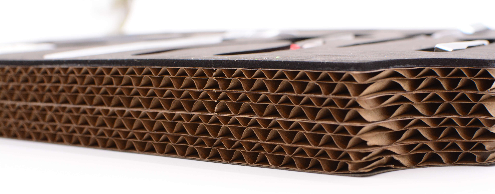

### Material

- **Klebtool** (3D-gedruckt; Modell im Repo: [prod/Gluing-Tool.stl](prod/Gluing-Tool/Gluing-Tool.stl), Quelle: [src/CAD/Gluing-Tool.FCStd](src/CAD/Gluing-Tool/Gluing-Tool.FCStd))
- **Ponal Express Leim**, aufgetragen mit einer **kleinen Malerrolle** + **Farbwanne**
- **Prittstift** (zum Ankleben der Bildausschnitte)
- Ausgedruckte **Werkzeughintergrundbilder** auf 160 g/m² Papier
- **Cutter**
- **Leuchttisch** (hilfreich, aber nicht zwingend nötig)

### Vorgehen

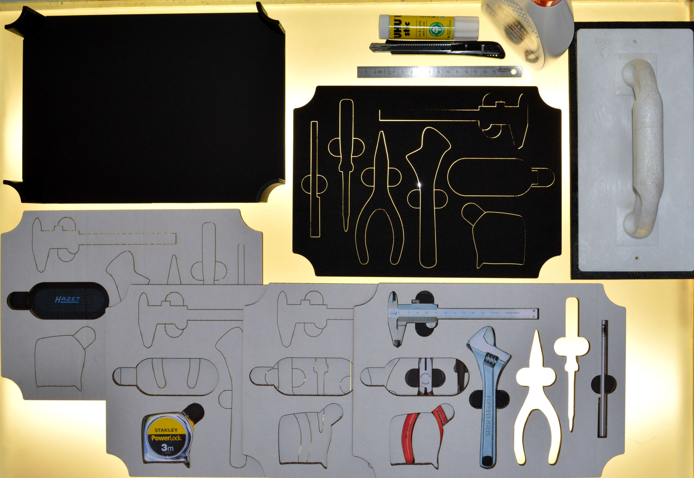

1. Alle gelaserten Teile und Werkzeuge/Kleber bereitlegen.
1. Wir starten mit der dünnen Hintergrundpappe (ohne Kontur), sie soll die hinterste Lage des Moduls werden. Also legen wir sie zunächst als Basis in das Kleb-Tool.
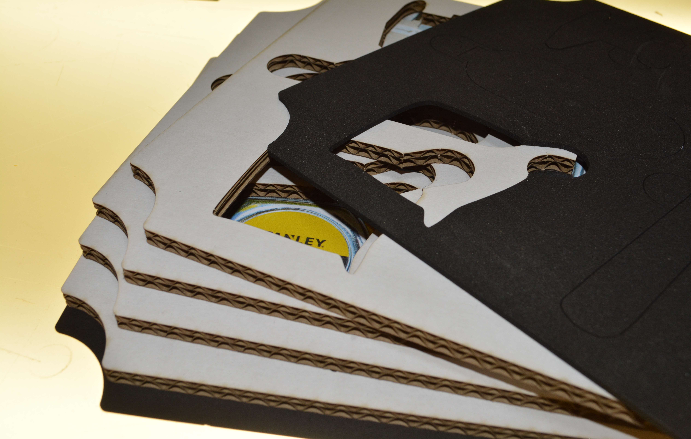

2. Pro Wellpappe-Lage, von unten nach oben:
   1. Die für diese Tiefe benötigten Pappkonturen aus der gelaserten Wellpappe herausbrechen (nur dort, wo ein Werkzeug genau auf dieser Tiefe eine Aussparung braucht).
   2. Mit dem Cutter die passenden Bildausschnitte aus dem Papier mit den Werkzeughintergrundbildern ausschneiden, mit reichlich Rand (so wie es möglich ist) drumherum – nur die Bilder der Werkzeuge, deren Aussparung genau auf dieser Lage endet. 
   3. Mit dem Prittstift Kleber auf die unbedruckte Rückseite des Papierausschnitts auftragen und von hinten auf die passende Stelle der Pappe-Lage kleben (bedruckte Seite zeigt nach oben). Ein Leuchttisch hilft, die Position genau zu treffen.
   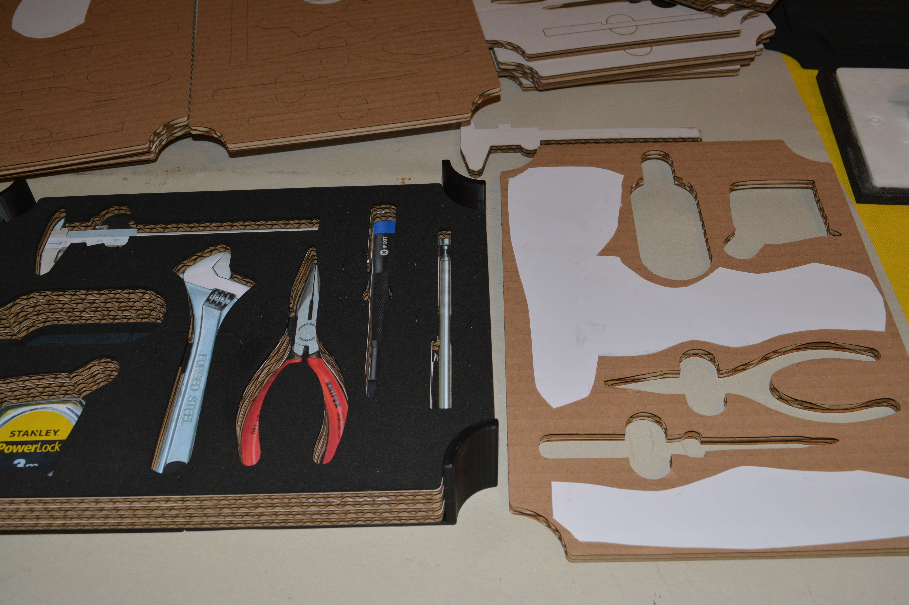
   4. Die gesamte Rückseite dieser Pappe-Lage mit Ponal Express (Malerrolle + Farbwanne) benetzen und mit dem Klebtool auf den bisherigen Stapel aufkleben. Bei dem ersten (untersten) Papplayer wird dieser auf die dünne Hintergrundpappe ohne Kontur aufgeklebt. 
   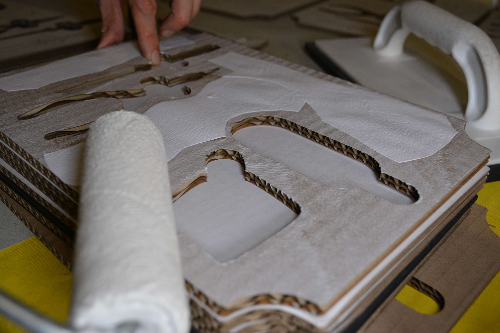
3. Schritt 2 für alle weiteren Wellpappe-Lagen wiederholen, sodass sich das Modul Lage für Lage aufbaut.
4. Zum Schluss die Moosgummi-Lage mit Kontur oben aufkleben.

---

# Produktion der Module auf Lochraster

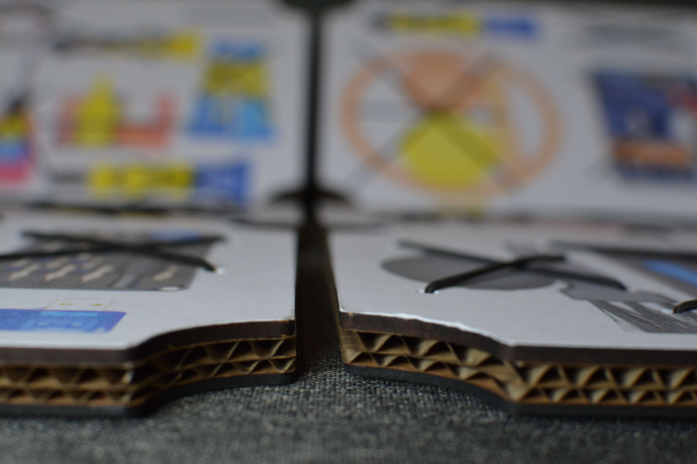

Prozess für die Erstellung der Hintergrundbilder, das sandwichmäßige Zusammenkleben der Module und die Herstellung/den Einsatz der Spanngummis.

## Erstellung der Hintergrundbilder für die Lochrasterplatten

### 1. Fotos machen

- Vor dem Fotografieren wird das auf **5 %** ausgedruckte Lochraster-Papier untergelegt.
- Die Items werden darauf so angeordnet, wie sie später auf der Lochrasterplatte tatsächlich liegen würden (gleiche Anordnung/Raster).
- **Weißabgleich:** auf den **schwarzen Hintergrund**, damit eine relativ helle Belichtung entsteht. (Weißabgleich vorher mit weißem Referenzbild einstellen)

### 2. Nachbearbeitung in GIMP

- Mit dem **Kurvenwerkzeug** den Hintergrund auf **komplettes Weiß** bringen.
- Schatten dabei möglichst ebenfalls entfernen/minimieren.
- Datei [Perspective-Correction-Guide.png](assets/modules/Perspective-Correction-Guide.png) als Ebene in das Bild ziehen.
  - Wird als Referenz für das **Perspektive-Werkzeug** genutzt, um das Foto ins korrekte Format zu ziehen (entzerren).
- Mit der **Käfig-Transformation** oder der **Verformen-(Warp-)Transformation** das Foto so anpassen, dass es auf die Schablone passt. Damit werden Verzerrungen entfernt, die beim Fotografieren entstehen (abhängig davon, wie weit die Kamera vom fotografierten Modul entfernt war).
- Mit dem **Zuschneiden-Werkzeug (Cropping)** auf das A4-Seitenverhältnis **1,414 : 1** zuschneiden – alles außenherum wegschneiden.
- Auf die korrekte Pixelgröße für **300 dpi bei A4** skalieren: **2480 × 3508 Pixel**.
- **Export als JPG.**

### 3. Weiterverarbeitung in Inkscape

- JPG importieren.
- Eine **weiße Ebene mit 30 % Deckkraft** darüberlegen (siehe [DESIGN-DECISIONS.de.md](DESIGN-DECISIONS.de.md) – 70 % Deckkraft der Drucklayer).
- **Export als PDF.**

### 4. Druck

- Druck des PDFs auf **160 g/m²** Papier.
- Der Druck erfolgt **borderless** (randlos).

## Spanngummis (Gummibänder mit T-Splinten)

- Jedes Werkzeug/Item wird mittels **Spanngummis** – Gummibändern mit **T-Splinten an beiden Enden** – fixiert und bekommt so eine feste Position.
- Pro Item kommen meist **zwei Spanngummis** zum Einsatz.
- Werden die Spanngummis selbst hergestellt, müssen sie entsprechend abgelängt werden. Folgende Längen kommen zum Einsatz:
  - 40 mm
  - 70 mm
  - 100 mm
  - 130 mm
  - (selten) 180 mm

## Reihenfolge der Arbeitsschritte

1. Ein Lochrastermodul nehmen und ein passendes Bild (Hintergrundbild, siehe oben) auf die Lochrasterplatte kleben – **trocknen lassen**.
2. Die Löcher an den richtigen Positionen stanzen, z. B. über einem Lichttisch.
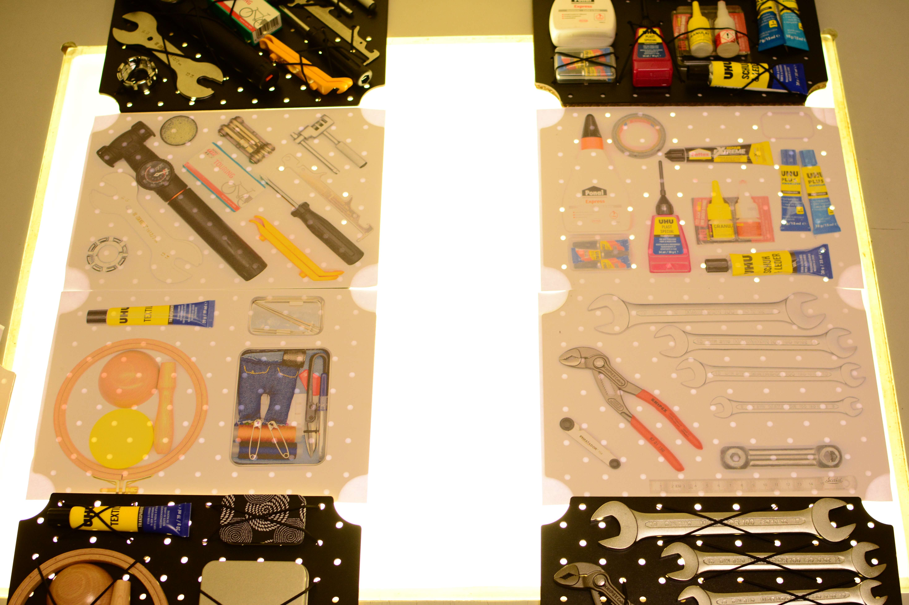
3. Die überstehenden Papierränder abschneiden mit einem scharfen Cuttermesser.
4. Die Gummibänder (Spanngummis) entsprechend platzieren.
5. Die einzelnen Layer (Sandwich) verkleben (siehe unten).

## Die einzelnen Layer verkleben

### Aufbau des Sandwich (von oben nach unten)

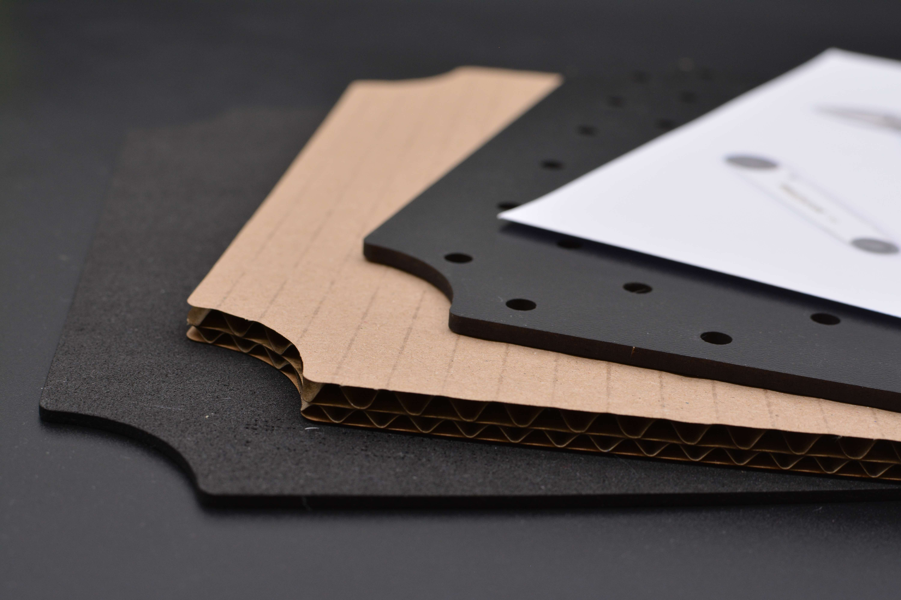

1. **Papier** mit den aufgedruckten Tools, gedruckt auf **160 g/m²**.
2. **Lochraster-Platine** (MDF).
3. **Pappschicht**.
4. **Moosgummischicht** (unten).

Druck- und Laser-Cutting-Dateien: [prod/modules](prod/modules)

### Vorgehen

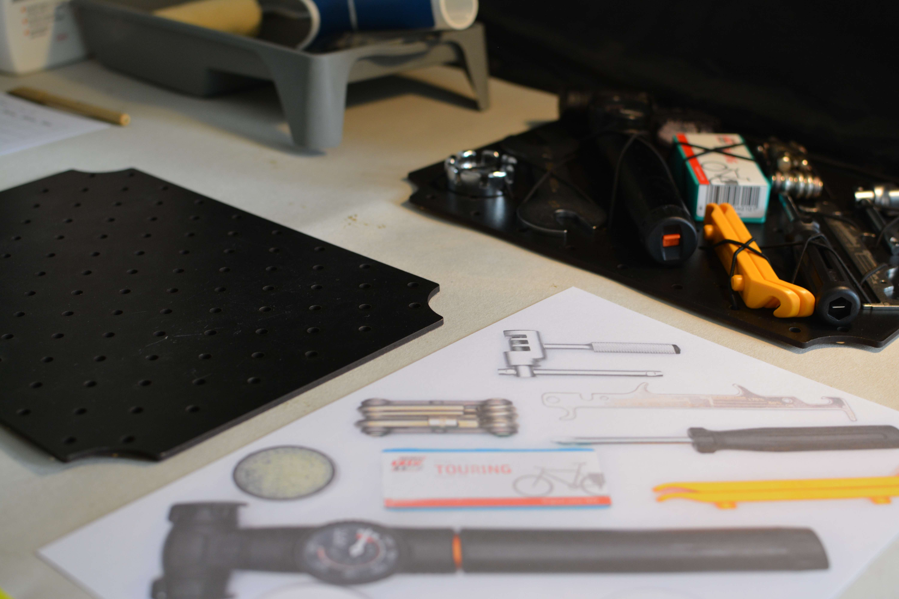

1. Die mit dem Hintergrundbild beklebte Lochraster-Platine (MDF) wird mit den Gummibändern bestückt. **Erst danach geht es weiter.**
2. Der nächste Schritt wird am besten mit dem **Klebtool** durchgeführt (3D-Druckdatei liegt im Repo, es geht aber auch ohne).
3. Der Papp-Layer wird auf den Tisch gelegt und die Lochraster-Platine oben darauf platziert. Durch festes Andrücken drücken sich die T-Splinte etwas in die Pappschicht ein und markieren so die Positionen. (ggf. kann man die T-Splinte mit einem Filzstift bemalen, damit die Position auf der Wellpappe besser sichtbar wird/abfärbt beim andrücken.)
4. Die Lochraster-Platine wieder zur Seite nehmen und an den markierten Stellen die Pappschicht durchstechen, z. B. mit der Rückseite eines Stifts. Dadurch können die T-Splinte später dort versenkt werden und sich alles gut zusammenkleben lässt.
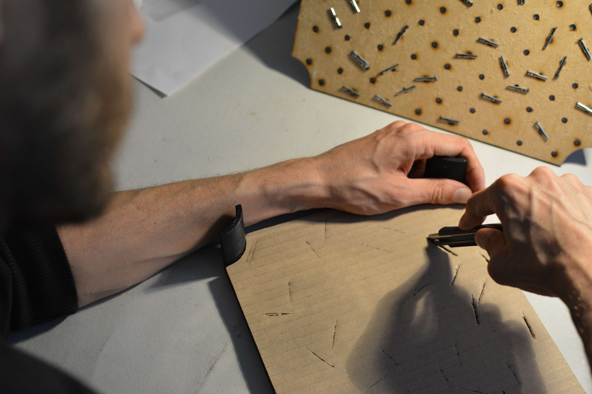
5. Moosgummi auf die Pappe kleben.
6. Die Lochraster-Platine oben auf Moosgummi + Pappe legen und kräftig andrücken.
7. Alles gut beschweren und eine Weile trocknen lassen.

### Klebehinweise

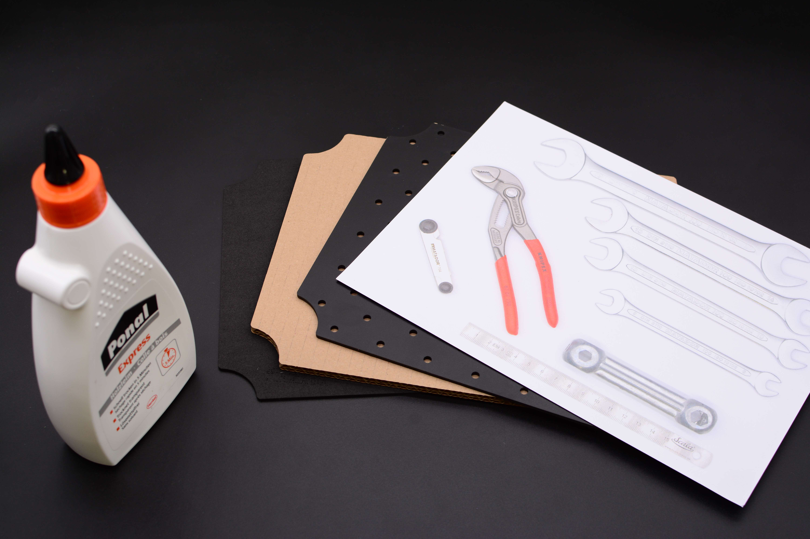

- Verwendet wird **Ponal Express Leim**.
- Bewährt hat sich der Auftrag mit einer **kleinen Malerrolle**.
- Möglichst gleichmäßig, und nicht zu viel Leim auftragen – insbesondere die Pappe saugt sich sonst voll und verzieht sich etwas.

---

# Produktion der Versandsicherung

Die Versandsicherung besteht aus zwei Schaumstoffteilen (Boden + Oberteil), die die Module in der Versandkiste gegen Verrutschen und Beschädigung sichern. Hintergrund zu den Designentscheidungen: siehe [DESIGN-DECISIONS.de.md](DESIGN-DECISIONS.de.md).

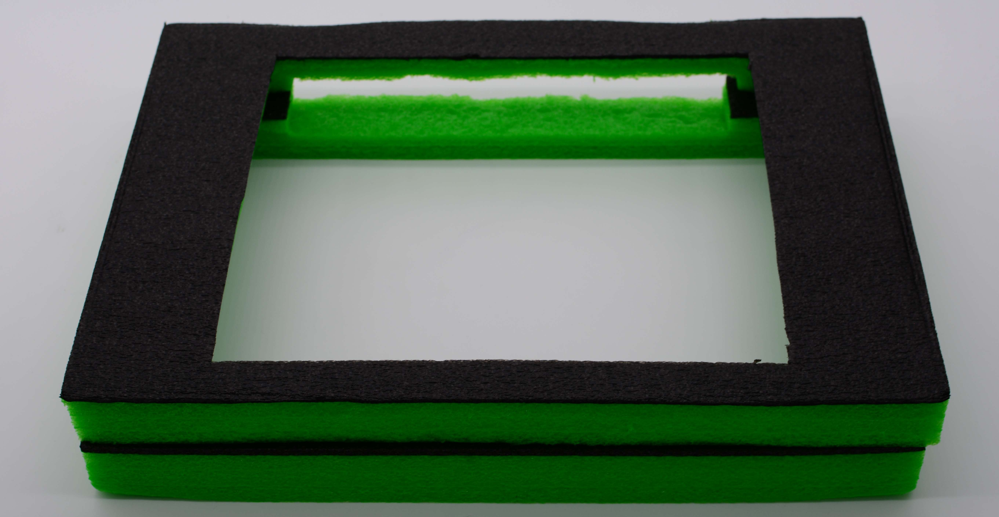

## Teile

1. **Boden-Teil** – Quelle: [src/CAD/packaging/Shipping-Protection_Bottom.FCStd](src/CAD/packaging/Shipping-Protection_Bottom.FCStd), Produktionsdatei: [prod/packaging/Shipping-Protection_Bottom.svg](prod/packaging/Shipping-Protection_Bottom.svg)
2. **Oberteil** – sichert die Module zusätzlich gegen Hin- und Herrutschen; an der linken und rechten inneren Kante schräg geschnitten, damit es sich in die Radien der Pappmodule einfügt und so eine gute Klemmung entsteht. Quelle: [src/CAD/packaging/Shipping-Protection_Top.FCStd](src/CAD/packaging/Shipping-Protection_Top.FCStd), Produktionsdatei: [prod/packaging/Shipping-Protection_Top.svg](prod/packaging/Shipping-Protection_Top.svg)

## Schneiden

### Material

- **ShadowFoam, 30 mm dick.** Bestelllink/-angabe siehe [BOM.fods](BOM.fods).

### Werkzeug

- **Schneideunterlage** – z. B. eine dafür geeignete Schneidematte (oder etwas vergleichbares).
- **Cuttermesser** – ein normales Cuttermesser reicht aus, das [von iFixit](https://www.ifixit.com/de-de/products/precision-utility-knife) ist gut geeignet. (ShadowFoam legt manchen Paketen auch passende Schneidemesser bei.)
- **Langes Lineal**, idealerweise ein **Winkel aus Metall** – aus Metall, damit man nicht versehentlich ins Lineal selbst reinschneidet.

### Vorgehen

1. Die technischen Zeichnungen des jeweiligen Teils bereitlegen – am Computer oder ausgedruckt.
2. Anhand der technischen Zeichnung und der Maßangaben zurechtschneiden.

**Tipp zum Anzeichnen:** Auf dem ShadowFoam lässt sich schlecht anzeichnen. Nachdem man ein Maß abgemessen hat, einmal kurz einritzen. Zusätzlich kann man direkt daneben – auf der Seite, die eh wegfällt – einen kleinen Halbbogen rausschneiden: darunter kommt eine hellere Schaumstoff-Lage zum Vorschein, an der man erkennt, wo man geschnitten/gemessen hat. Ohne diesen Trick sieht man den Schnitt auf der dunklen Oberfläche sonst kaum.

### Technik für gerade Schnitte

- In der Regel: einmal am Lineal entlang schneiden, danach noch **2–3 Mal tiefer nachschneiden**. Das braucht etwas Übung, bis die Kante sauber wird.
- Das Cuttermesser **nicht zu weit ausfahren** – sonst wird die Schnittkante schräg/schief.
- Beim erneuten Durchfahren eines schon bestehenden Schnitts das Messer entsprechend hineindrücken, um an der Schnittkante im Material zu bleiben – aber nicht zu stark.
- Für schräge Schnitte: erst die geraden Schnitte üben, danach fällt der schräge Schnitt leichter.

### Vertiefungen im ShadowFoam

- Von der Seite sind die einzelnen Lagen des ShadowFoam sichtbar – anhand dieser Lagen entscheidet man, bis zu welcher Tiefe geschnitten werden soll.
- Auf beiden Seiten entsprechend tief einschneiden.
- Das Stück danach vorsichtig heraustrennen: **nicht nach oben wegziehen**, sondern **parallel zur ShadowFoam-Oberfläche** abziehen und dabei direkt an der Reißkante mit den Fingern gegenhalten – so bleibt die Oberfläche halbwegs sauber.

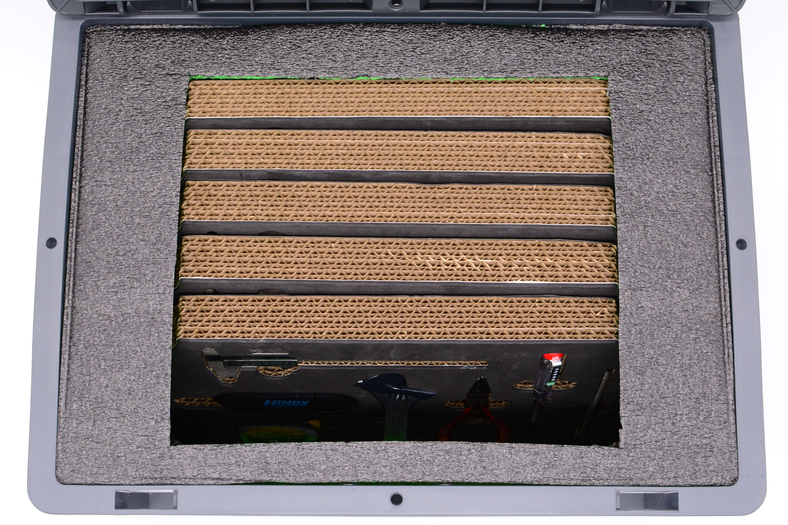