# Production of the Laser-Cut Corrugated-Cardboard Modules

[[**PRODUCTION auf Deutsch**](/PRODUCTION.de.md)]

> **Primarily refers to the shadowboard version; the pegboard/elastic-cord version follows further below.**

## Creating the Contours

Tool used: **Inkscape**.

### 1. Photograph the Tool

- The tool is photographed against a suitable background – a **light background** usually works best.
- Alternatively, a **product image from the manufacturer's/shop's website** can sometimes be used instead.

### 2. Dimension and Rectangle

- The tool is measured.
- The photo is placed in Inkscape, together with a rectangle ("block") created at the measured height and made semi-transparent.
- The photo is then scaled to fit this rectangle.

### 3. Draw the Contour

- The contour is drawn **by hand with the path tool** around the tool.
- **Learning:** Automatically generating the contour from the photo via "trace bitmap to path" turned out to be unsuitable – it produces an extremely large number of path points, which can cause Inkscape to crash.

### 4. Corner Radius

- For some contours it makes sense to use the **Corners** path effect to apply a radius (e.g. 1 mm or a bit more) to the corners – it looks nicer.

### 5. Offset Due to Laser Kerf

- In Inkscape: **Path Effect** → **Offset**. This lets you enlarge or shrink the entire contour by a fixed amount.
- We **shrank the contour by 0.15 mm** to compensate for the thickness of the laser beam.
- The exact value depends on the laser cutter being used.

### 6. Tabs/Bridges

- Tabs keep the cut-out parts from falling straight out of the cardboard – generally recommended.
- In our case, the tabs were not created in Inkscape but generated via the **xTool software**.

### 7. Testing and Fine-Tuning

- It's best to be **at the computer directly next to the laser cutter**, with the **tools that are meant to fit later on hand**.
- Process: laser-cut → check the fit with the actual tools → correct in Inkscape → laser-cut again.
- Usually **several iterations** are needed until the contour fits.

## Laser-Cutting the Individual Parts (Layers)

Laser-cutting files: [prod/modules](prod/modules)

Laser cutter used: **xTool**, 40 W CO2 laser. The following settings apply to it:

| Material | Power [%] | Speed [mm/s] |
| --- | --- | --- |
| Corrugated cardboard 6.3 mm | 45 | 30 |
| Black MDF 5 mm | 40 | 18 |
| Black solid board 0.3 mm | 20 | 50 |
| Foam 3 mm | 30 | 70 |

- These values apply to the laser cutter mentioned above and may vary depending on the device used.
- It's best to run a **speed-vs-power test** (a test matrix, as is common for laser cutting) for your own device.
- Software other than the one supplied by the respective laser-cutter manufacturer can also be used – the source and production files are available in this repo for that purpose.
- **Mind the corrugation direction of the cardboard:** we aligned the corrugation **parallel to the short side** – so when the module is lying in front of you, it runs from top to bottom (not from left to right).
- The edges of the laser-cut parts can be **vacuumed to remove soot**.

## Creating the Background Images

- Take a few of the laser-cut cardboard parts and punch out only the needed contours – this lets you assemble/position a module **without gluing**, as a trial.
- Place the tools into the module assembled this way.
- Photograph the whole thing against a high-contrast background.
- Post-process brightness/contrast (e.g. with GIMP or another program) so the tools are clearly recognizable.
- Crop/adjust to A4 (equivalent to the post-processing described further below in the GIMP section for the pegboard modules: correcting lens curvature, slight repositioning if needed, etc.).
- Print borderless (on thick paper).

## Gluing

Required layers (build-up from bottom to top):

1. **Thin background cardboard without a contour** – the base, becomes the back of the module.
2. **Several layers of laser-cut cardboard with a contour** – each with only the cutouts actually needed at that depth (the deepest tool accordingly needs a cutout in most of the layers). The background image with the tool (printed on paper) is glued on here.
3. **Foam rubber with a contour** (top) – with the same cutouts as the topmost cardboard layer.

Photos of the tools: for each layer, only glue on the image section of the tools whose cutout ends exactly at that depth.

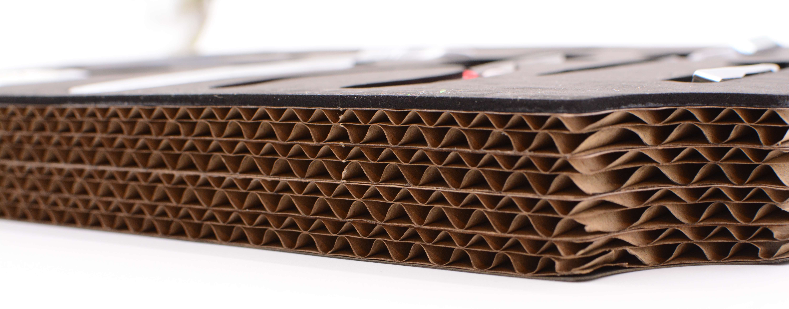

### Materials

- **Gluing tool** (3D-printed; model in the repo: [prod/Gluing-Tool.stl](prod/Gluing-Tool/Gluing-Tool.stl), source: [src/CAD/Gluing-Tool.FCStd](src/CAD/Gluing-Tool/Gluing-Tool.FCStd))
- **Ponal Express glue**, applied with a **small paint roller** + **paint tray**
- **Glue stick** (for attaching the image cutouts)
- Printed **tool background images** on 160 g/m² paper
- **Cutter knife**
- **Light table** (helpful, but not strictly necessary)

### Procedure

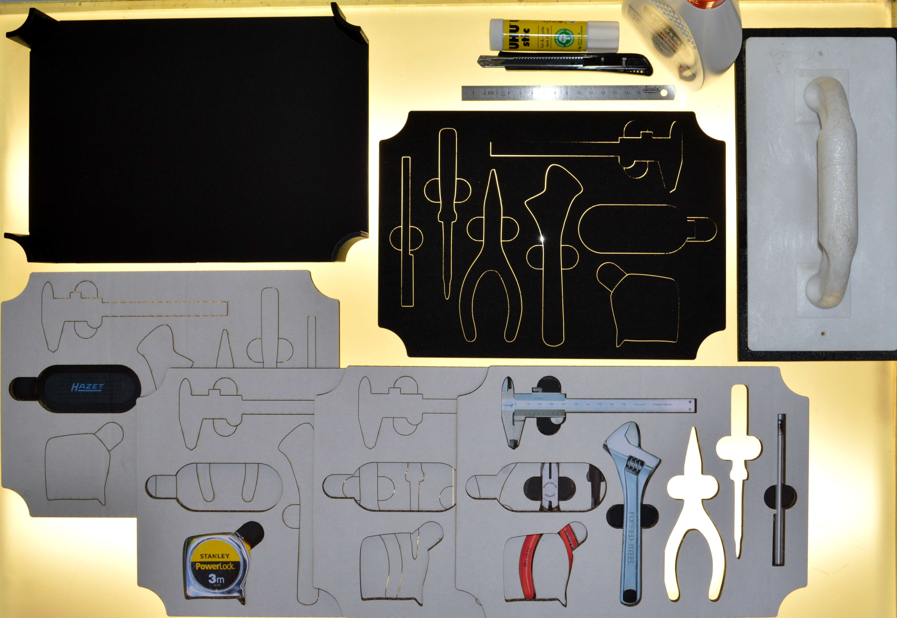

1. Lay out all laser-cut parts and tools/glue.
1. We start with the thin background cardboard (without a contour) – it becomes the rearmost layer of the module. So we place it first as the base in the gluing tool.
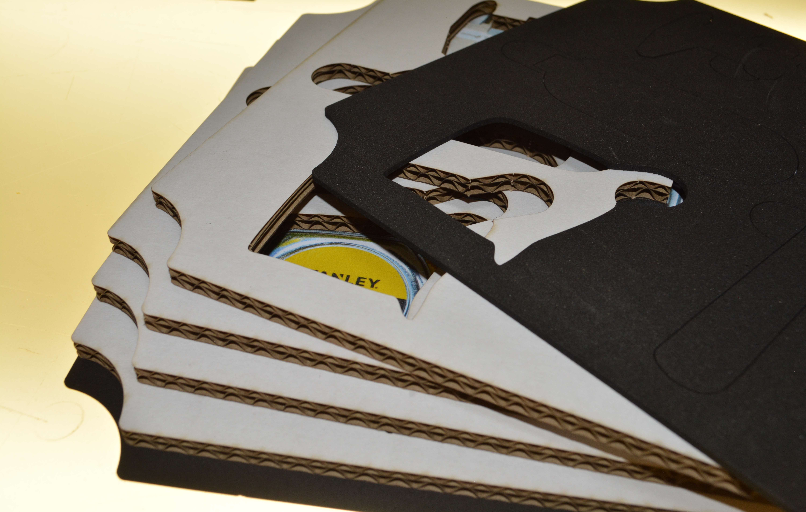

2. For each cardboard layer, from bottom to top:
   1. Break out the cardboard contours needed at that depth from the laser-cut sheet (only where a tool needs a cutout exactly at that depth).
   2. Use the cutter to cut out the matching image sections from the paper with the tool background images, leaving a generous margin (as far as possible) around them – only the images of the tools whose cutout ends exactly at this layer.
   3. Apply glue stick to the unprinted back of the paper cutout and glue it, from behind, onto the matching spot of the cardboard layer (printed side facing up). A light table helps to position it precisely.
   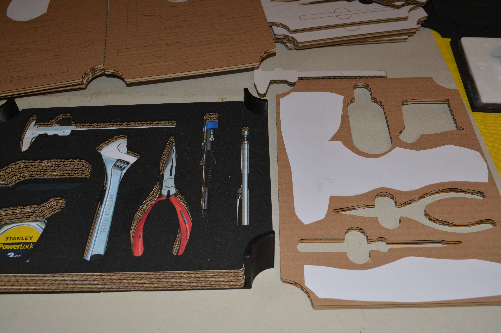
   4. Coat the entire back of this cardboard layer with Ponal Express (paint roller + tray) and glue it onto the stack built up so far using the gluing tool. For the first (bottommost) cardboard layer, it is glued onto the thin background cardboard without a contour.
   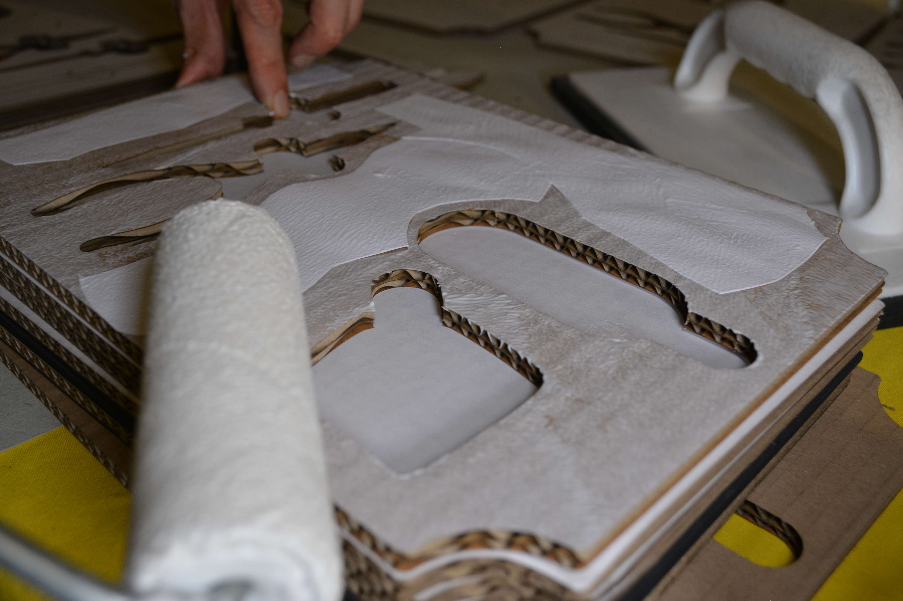
3. Repeat step 2 for all further cardboard layers, so the module is built up layer by layer.
4. Finally, glue on the foam-rubber layer with the contour on top.

---

# Production of the Pegboard Modules

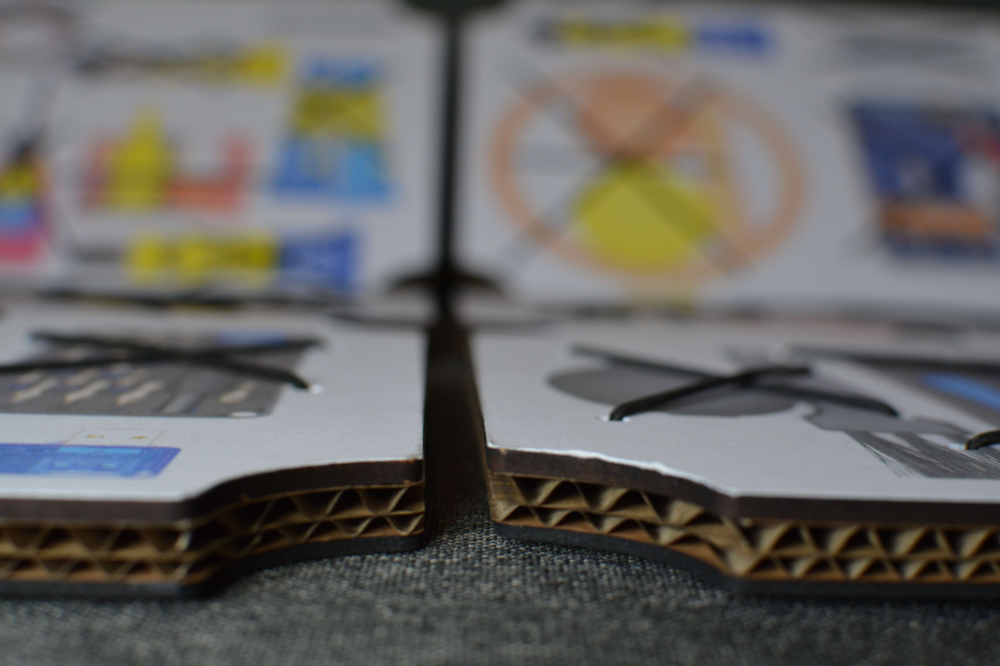

Process for creating the background images, sandwich-gluing the modules together, and making/using the elastic cords.

## Creating the Background Images for the Pegboards

### 1. Taking Photos

- Before photographing, the **5%**-scale printed pegboard-grid paper is placed underneath.
- The items are arranged on it the way they will actually sit on the pegboard later (same layout/grid).
- **White balance:** set against the **black background**, so a relatively bright exposure results. (Set the white balance beforehand using a white reference image.)

### 2. Post-Processing in GIMP

- Use the **Curves tool** to bring the background to **pure white**.
- Remove/minimize shadows as far as possible at the same time.
- Drag the file [Perspective-Correction-Guide.png](assets/modules/Perspective-Correction-Guide.png) into the image as a layer.
  - It's used as a reference for the **Perspective tool**, to pull the photo into the correct shape (de-skewing).
- Use the **Cage Transform** or the **Warp Transform** to adjust the photo so it fits the template. This removes distortions that occur during photography (depending on how far the camera was from the module being photographed).
- Use the **Crop tool** to crop to the A4 aspect ratio of **1.414 : 1** – cutting away everything around the edges.
- Scale to the correct pixel size for **300 dpi at A4**: **2480 × 3508 pixels**.
- **Export as JPG.**

### 3. Further Processing in Inkscape

- Import the JPG.
- Place a **white layer at 30% opacity** on top (see [DESIGN-DECISIONS.md](DESIGN-DECISIONS.md) – 70% opacity of the print layer).
- **Export as PDF.**

### 4. Printing

- Print the PDF on **160 g/m²** paper.
- Printing is **borderless**.

## Elastic Cords (Rubber Bands with T-Pins)

- Each tool/item is held in place with **elastic cords** – rubber bands with **T-pins on both ends** – giving it a fixed position.
- Usually **two elastic cords** are used per item.
- If the elastic cords are made in-house, they need to be cut to length accordingly. The following lengths are used:
  - 40 mm
  - 70 mm
  - 100 mm
  - 130 mm
  - (rarely) 180 mm

## Order of Work Steps

1. Take a pegboard module and glue a matching image (background image, see above) onto the pegboard – **let it dry**.
2. Punch the holes at the correct positions, e.g. over a light table.
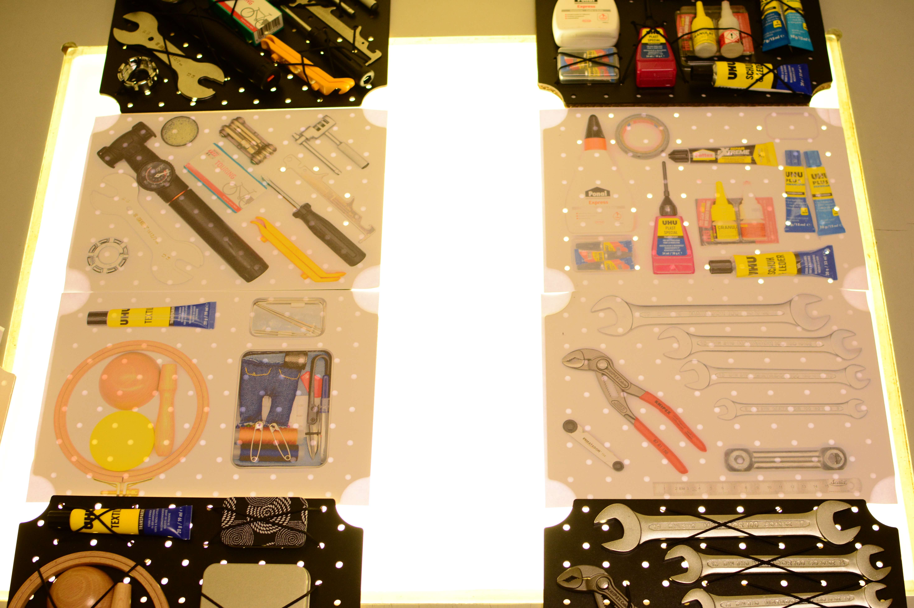
3. Trim the overhanging paper edges with a sharp cutter knife.
4. Place the rubber bands (elastic cords) accordingly.
5. Glue the individual layers (sandwich) together (see below).

## Gluing the Individual Layers

### Sandwich Build-Up (from top to bottom)

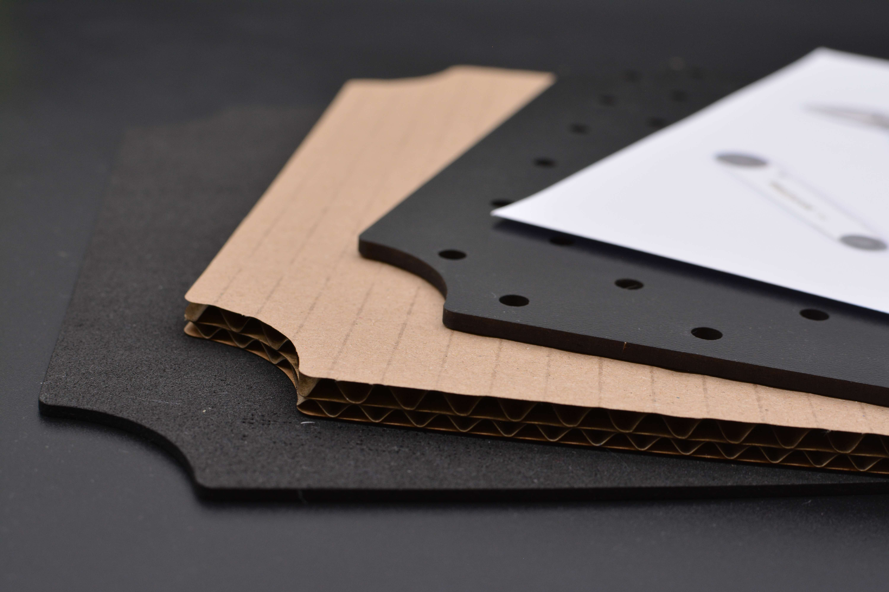

1. **Paper** with the printed tools, printed on **160 g/m²**.
2. **Pegboard panel** (MDF).
3. **Cardboard layer**.
4. **Foam-rubber layer** (bottom).

Print and laser-cutting files: [prod/modules](prod/modules)

### Procedure

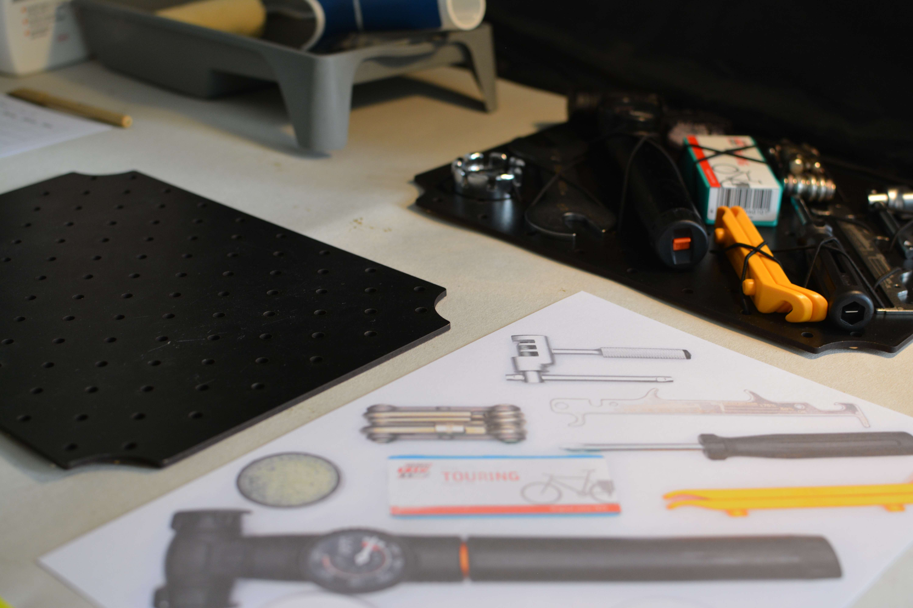

1. The pegboard panel (MDF), already glued with the background image, is fitted with the rubber bands. **Only proceed after this.**
2. The next step is best done with the **gluing tool** (3D-print file is in the repo, but it also works without it).
3. The cardboard layer is placed on the table and the pegboard panel is positioned on top of it. Pressing down firmly makes the T-pins press slightly into the cardboard layer, marking their positions. (You can color the T-pins with a felt-tip pen beforehand so the position on the cardboard shows up more clearly/leaves a mark when pressed.)
4. Set the pegboard panel aside again and pierce the cardboard layer at the marked spots, e.g. with the back end of a pen. This allows the T-pins to later be sunk in there and lets everything glue together well.
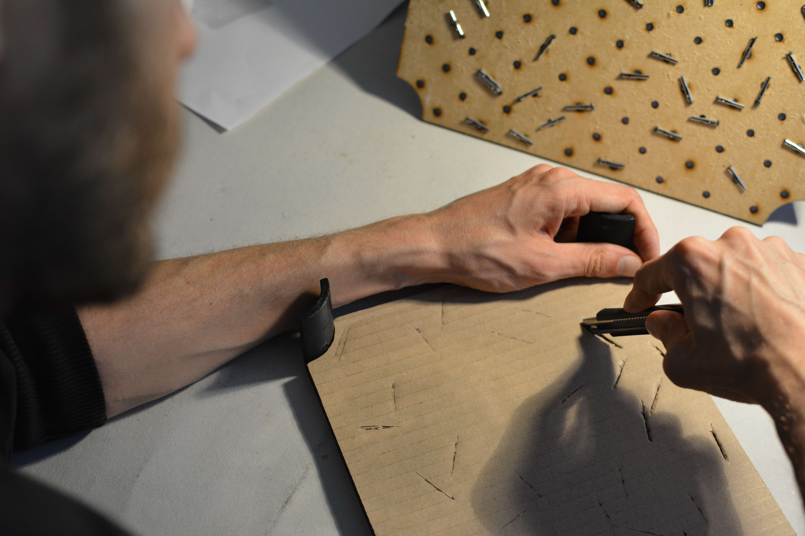
5. Glue the foam rubber onto the cardboard.
6. Place the pegboard panel on top of the foam rubber + cardboard and press down firmly.
7. Weigh everything down well and let it dry for a while.

### Gluing Notes

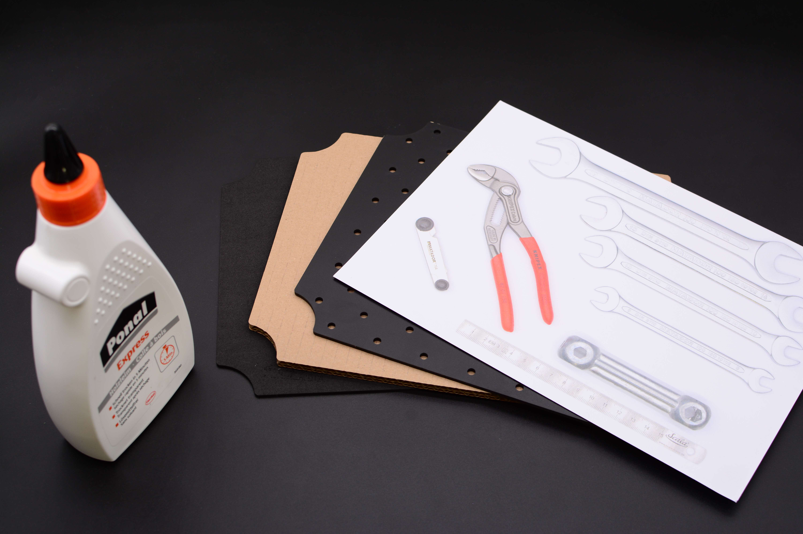

- **Ponal Express glue** is used.
- Applying it with a **small paint roller** has proven effective.
- Apply as evenly as possible, and not too much glue – otherwise the cardboard in particular soaks it up and warps slightly.

---

# Production of the Shipping Protection

The shipping protection consists of two foam parts (bottom + top) that secure the modules inside the shipping box against shifting and damage. Background on the design decisions: see [DESIGN-DECISIONS.md](DESIGN-DECISIONS.md).

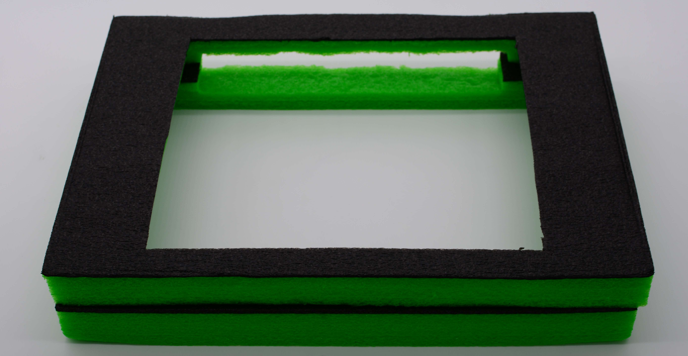

## Parts

1. **Bottom part** – source: [src/CAD/packaging/Shipping-Protection_Bottom.FCStd](src/CAD/packaging/Shipping-Protection_Bottom.FCStd), production file: [prod/packaging/Shipping-Protection_Bottom.svg](prod/packaging/Shipping-Protection_Bottom.svg)
2. **Top part** – additionally secures the modules against sliding back and forth; cut at an angle on the left and right inner edge so it fits into the radii of the cardboard modules, creating a good clamping effect. Source: [src/CAD/packaging/Shipping-Protection_Top.FCStd](src/CAD/packaging/Shipping-Protection_Top.FCStd), production file: [prod/packaging/Shipping-Protection_Top.svg](prod/packaging/Shipping-Protection_Top.svg)

## Cutting

### Material

- **ShadowFoam, 30 mm thick.** For ordering info, see [BOM.fods](BOM.fods).

### Tools

- **Cutting mat** – e.g. a suitable cutting mat (or something comparable).
- **Cutter knife** – a regular cutter knife is sufficient; the [one from iFixit](https://www.ifixit.com/de-de/products/precision-utility-knife) works well. (Some ShadowFoam packages also come with a suitable cutting knife included.)
- **Long ruler**, ideally a **metal square** – made of metal so you don't accidentally cut into the ruler itself.

### Procedure

1. Have the technical drawings of the respective part ready – on the computer or printed out.
2. Cut to size based on the technical drawing and the dimensions given.

**Tip for marking:** ShadowFoam is hard to mark on. After measuring a dimension, make a brief scoring mark. In addition, you can cut a small half-circle notch right next to it – on the side that's being discarded anyway: this reveals a lighter foam layer underneath, letting you see where you measured/cut. Without this trick, the cut is barely visible on the dark surface.

### Technique for Straight Cuts

- Generally: cut once along the ruler, then go over it **2–3 more times, cutting a bit deeper** each time. It takes some practice to get a clean edge.
- Don't **extend the cutter blade too far** – otherwise the cut edge comes out angled/skewed.
- When going over an existing cut again, press the knife in accordingly to stay in the cut line in the material – but not too hard.
- For angled cuts: practice the straight cuts first, then the angled cut becomes easier.

### Recesses in the ShadowFoam

- From the side, the individual layers of the ShadowFoam are visible – these layers are used to judge how deep to cut.
- Cut deep enough on both sides accordingly.
- Then carefully detach the piece: **don't pull it straight up**, but pull it off **parallel to the ShadowFoam surface**, holding it steady with your fingers right at the tear edge – this keeps the surface reasonably clean.

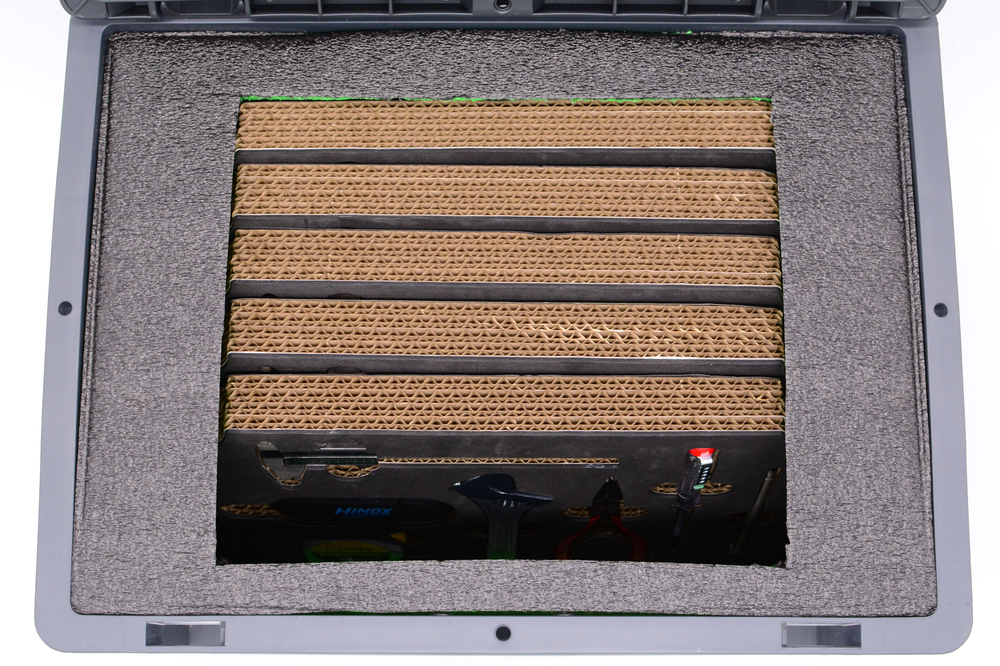
