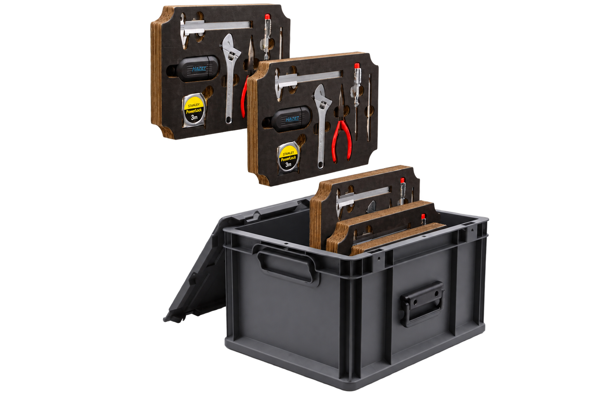
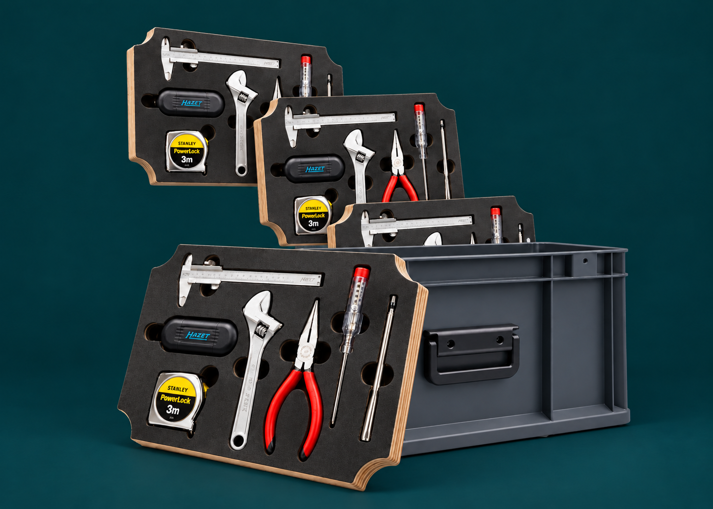
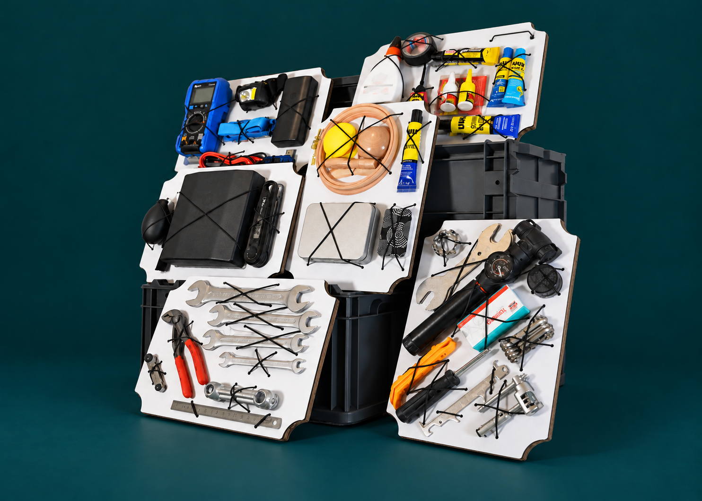
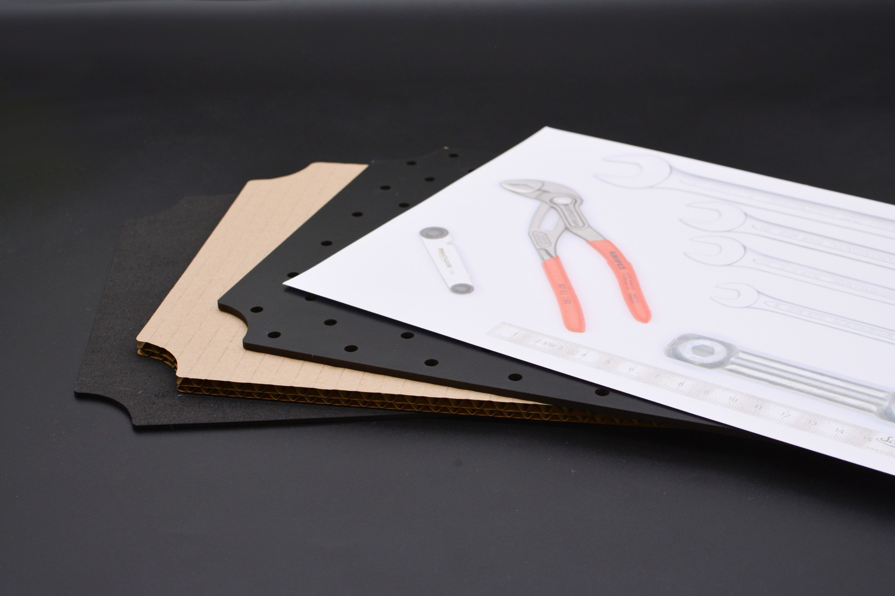

# Educational Repair Kit

[[**README in English**](/README.md)]



Dieses Repository dokumentiert die **Repair-Education**-Toolkits, die für den Reparaturunterricht entwickelt wurden: ein allgemeiner Klassensatz mit Basiswerkzeugen (**Klassensatz**) sowie thematische Spezialsets (**Sondersets**) zu Fahrradreparatur, Elektronik, Textilien und Kleben. Neben den Konstruktionen der physischen Kits enthält dieses Repository auch das zugehörige didaktische Konzept zur Vermittlung von Reparaturkompetenzen – die pädagogischen Materialien werden ebenfalls hier gepflegt.

Website: <https://askotec.openculture.agency/reparaturkit>

## Hauptmerkmale

* **Bildungsfokus**: Entwickelt, um eine große Bandbreite an Lernszenarien abzudecken, und mit einem begleitenden didaktischen Konzept versehen.
* **Modularer Aufbau**: Das Kit ist modular aufgebaut und lässt sich dadurch an verschiedene Reparaturszenarien anpassen. Neue Module für spezifische Anforderungen können einfach ergänzt werden.
* **Übersichtliche Organisation**: Jedes Werkzeug hat seinen festen Platz, sodass auf den ersten Blick erkennbar ist, welche Werkzeuge fehlen.
* **Open Source**: Die vollständige Dokumentation zu Aufbau und Inhalt des Kits ist hier verfügbar. Du kannst das Design [nachbauen](/prod/), [verändern](/src/) und [verbessern](https://github.com/opencultureagency/Repair-Education/issues), um es an deine eigenen Bedürfnisse anzupassen und neue Module für andere Anwendungsfälle zu erstellen.





## Anwendungsspezifische Zusammenstellungen

Unterschiedliche Anwendungsszenarien erfordern unterschiedliche Kits. Jede Kombination der in diesem Repository dokumentierten Module und didaktischen Materialien kann zu einem Koffer zusammengestellt werden, der auf das jeweilige Szenario zugeschnitten ist. Wähle und kombiniere, was passt, um deine eigene Zusammenstellung zu erstellen.

In seiner ursprünglichen Form war das Modul Basiswerkzeuge ([repair-m04a](/docs/repair-m04a.md), später umgewandelt in [-m04b](/docs/repair-m04b.md)).

Die jeweiligen Anwendungsbereiche der einzelnen Module sind in der jeweiligen Moduldokumentation beschrieben.

## Enthaltene Module

- [repair-m04b](docs/repair-m04b.md): **Basiswerkzeuge** (mit iFixit-4-mm-Bit-Halter) – Variante: [repair-m04a](docs/repair-m04a.md)
- [repair-m06](docs/repair-m06): Fahrrad-Basics
- [repair-m07](docs/repair-m07): Schraubenschlüssel
- [repair-m08](docs/repair-m08): Elektronik-Basics
- [repair-m09](docs/repair-m09): Elektronik-Fehlersuche
- [repair-m10](docs/repair-m10): Textilien
- [repair-m11](docs/repair-m11): Kleben



## Produktion

Der detaillierte Produktionsprozess ist unter [Produktion](PRODUCTION.de.md) beschrieben, die Hintergründe zu den Designentscheidungen und offene Fragen unter [Design Decisions & Notes](DESIGN-DECISIONS.de.md).

## Rendering der Dokumentation

Um die Dokumentation mit Pandoc als PDF zu rendern, verwende die Datei [template.tex](/docs/template.tex), damit mit pandoc ein ansprechendes PDF erzeugt wird (inklusive der aktuellen Git-Repository-`version`):

Wechsle dazu in den Ordner `/docs` und führe folgenden Befehl aus:

```bash
pandoc *.md --template=template.tex -V version="$(git describe --tags --always)" -o ../gen/Manual-EN.pdf
```

Oder, wenn du die deutsche DE-Version erzeugen möchtest, wechsle in das Verzeichnis `/docs/DE` und führe aus:

```bash
pandoc *.md --template=../template.tex -V version="$(git describe --tags --always)" -o ../../gen/Manual-DE.pdf
```

## Credits

Dieses Kit basiert auf seinem Vorgänger, dem [Repair-Kit](https://github.com/opencultureagency/Repair-Kit), dessen ursprüngliches Design von [repami.de](https://repami.de), einem Netzwerk für qualitativ hochwertige Reparaturen in Berlin, unterstützt wurde.

Für die gesamte Dokumentation wenden wir die [CC-BY-SA 4.0](/LICENSE_CC_BY-SA.md) an. Darüber hinaus gilt für die technischen Dateien (insbesondere in [/src/](/src/) und [/src/CAD](/src/CAD/)) die [CERN-OHL-W-2.0-or-later](/LICENSE_cern_ohl_w_v2.txt), um eine bessere Integration zu ermöglichen (dies schließt auch alle produktionsbezogenen Exporte im Verzeichnis [/prod/](/prod/) ein).

### Repository-Struktur

* `/`: Das Wurzelverzeichnis enthält die technische README, BOM, PRODUCTION, DESIGN-DECISIONS und LICENSE als Leitinformationen zum Projekt.
* `assets/`: Hier können zusätzliche Dateien und Bilder abgelegt werden.
* `docs/`: Nutzerorientierte Dokumentation der Module, die gerendert werden soll.
* `src/`: Hier werden neue Quelldateien abgelegt.
* `prod/`: Für reine Produktionsdateien (Exporte, ohne eingebettete Bilder usw.).

> Lege bei Bedarf hier neue Ordner an und folge dabei dem Standard [osh-dir-std](https://gitlab.com/OSEGermany/osh-dir-std/) (auf Root-Ebene bevorzugen wir vorerst `unixish`).
```