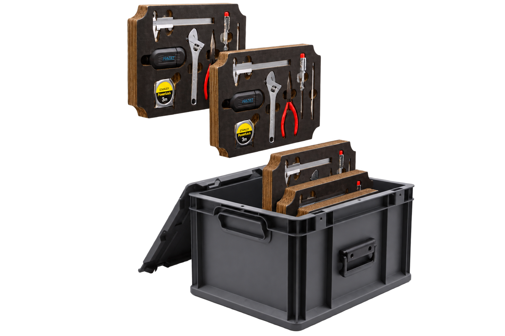
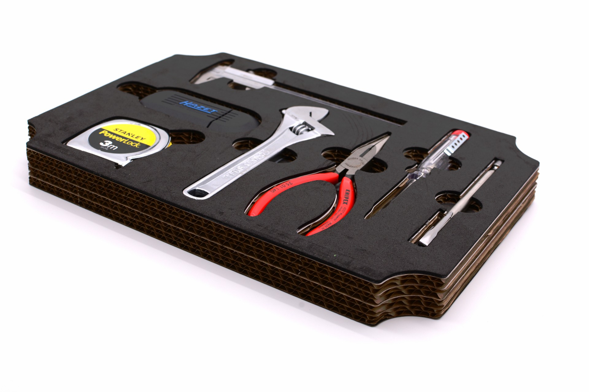
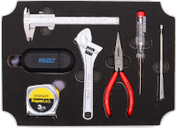

# Repair Kit

[[**README auf Deutsch**](/README_DE.md)]



This repository documents the **Repair Education** toolkits developed for teaching about repair (((in German schools on behalf of BUND))): a general basic-tools class set (**Klassensatz**) plus special topic sets (**Sondersets**) covering bike repair, electronics, textiles, and gluing. Alongside the physical kit designs, this repository also hosts the accompanying didactic concept for teaching repair skills — the pedagogical materials are maintained here as well.

Website: <https://askotec.openculture.agency/repairkit>

## Key Features

* **Educational Focus**: Designed to cover a wide range of learning scenarios, comes with an accompanying didactic concept.
* **Modular Design**: The kit is built in a modular fashion, allowing for customisation to fit various repair scenarios. The current version includes **basic equipment modules, for most relevant [application scenarios](#application-scenarios)**. You can easily add new modules for specific needs.
* **Clear Organisation**: Every tool has its place, making it easy to see which tools are missing at a first look.
* **Open Source**: The complete documentation for the kit's construction and contents is available here. You can [build](/prod/), [modify](/src/), and [improve](https://github.com/opencultureagency/Repair-Kit/issues) upon the design to suit your own needs and create new modules for different use cases and [case studies](#case-studies).



[[[[ hier ein Bild der Sondersets rein — oder beide Bilder ersetzen durch eines, in dem Basic tools & Sondersets sind ]]]]

## Application-Specific Compilations

Different application scenarios call for different kits. Any combination of the modules and didactic materials documented in this repository can be compiled into a case tailored to the scenario at hand. Pick and combine whatever fits to assemble your own compilation. 

[[[[ hier dann trotzdem  Klassensatz und Sondersets als jeweils eine Zusammenstellung aufführen? Vlt nur Klassensatz, weil Sondersets so vielfältig sind ]]]]

See the individual module documentation for the specific applications each one covers.

## Modules included

[[[ TODO: Links zu jeweiligen Readmes. Vlt kleines Bild wie unten?  ]]]

- repair-m04b: **Basic Tools**<br><br><br>
- repair-m06: Bike Basics
- repair-m07: Wrenches
- repair-m08: Electronics Basics
- repair-m09: Electronics Troubleshooting
- repair-m10: Textiles
- repair-m11: Gluing


[[[ anderes Bild ]]]


## Production

See [Production](docs/production.md) for the detailed production process, and [Design Decisions & Notes](docs/design-decisions.md) for the background design rationale and open questions.

## Dokumentation rendering

For rendering the documentation please refer to the [template.tex](/docs/template.tex) in order to generate a good PDF via pandoc (including the current Git Repository `version`):

make sure to navigate into the `/docs` folder an run the following command:

```bash
pandoc *.md --template=template.tex -V version="$(git describe --tags --always)" -o ../gen/Manual-EN.pdf
```

or if you want to generate the German DE version go into the `/docs/DE` directory and run:

```bash
pandoc *.md --template=../template.tex -V version="$(git describe --tags --always)" -o ../../gen/Manual-DE.pdf
```


## Credits

This kit is based on its predecessor, the [Repair-Kit](https://github.com/opencultureagency/Repair-Kit), whose initial design was supported by [repami.de](https://repami.de), a network for quality repairs in Berlin.

On all documentation we apply the [CC-BY-SA 4.0](/LICENSE_CC_BY-SA.md). Apart from that, on the technical files (in [/src/](/src/) and [/src/CAD](/src/CAD/) in specific) we apply the [CERN-OHL-W-2.0-or-later](/LICENSE_cern_ohl_w_v2.txt) for better integration (this also includes all production related exports to the [/prod/](/prod/) directory.). 

### Repository Structure

* `assets/`: Add additional files and images here. case studies, production, 
* `docs/`: Documentation for the modules, production, and design decisions.
* `src/`: Add new source files here.
* `prod/`: For pure production files (exports, without embedded images, etc.).
  
> Create new folders here if needed, following the [osh-dir-std](https://gitlab.com/OSEGermany/osh-dir-std/) standard (we prefer `unixish` at root level for now).
