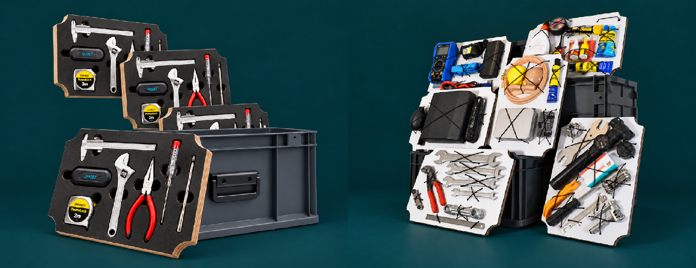

# Universelles Reparatur-Kit
**Bildungsedition**

(Deutsche Version)

## Enthaltene Module
- Basiswerkzeuge ([repair-m04a](repair-m04a.de.md) oder [Variante -m04b](repair-m04b.de.md))
- Fahrrad-Basics ([repair-m06](repair-m06.de.md))
- Schraubenschlüssel ([repair-m07](repair-m07.de.md))
- Elektronik-Basics ([repair-m08](repair-m08.de.md))
- Elektronik-Fehlersuche ([repair-m09](repair-m09.de.md))
- Textilien ([repair-m10](repair-m10.de.md))
- Kleben ([repair-m11](repair-m11.de.md))
- Extras: Verpackung & zusätzliche Materialinfos

---

**Website:** <https://askotec.openculture.agency/repairkit>
