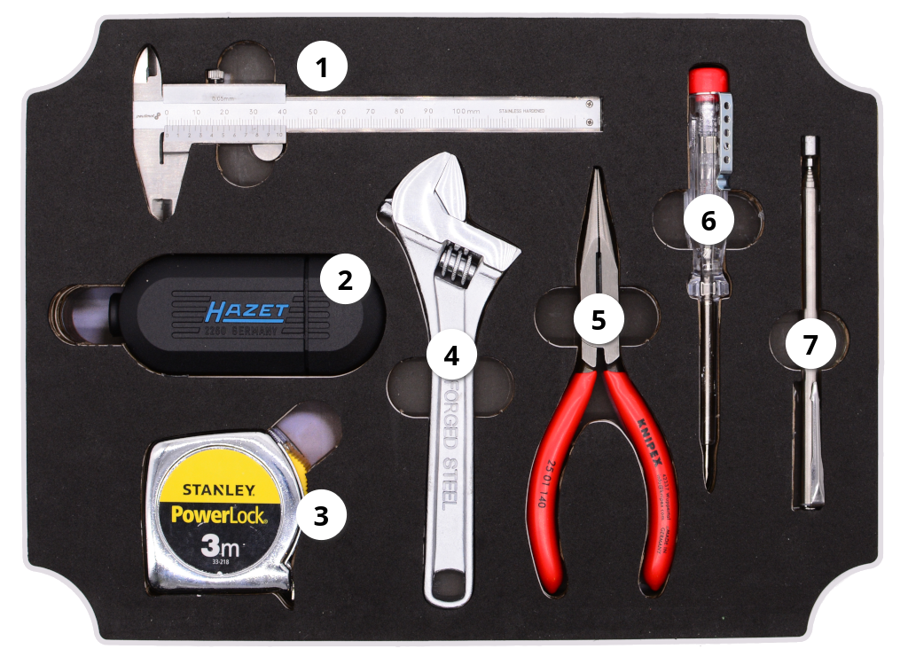

# Basiswerkzeuge (repair-m04a)

**Zusammenfassung:**

> Dieses Modul enthält alle grundlegenden Handwerkzeuge für die manuelle Arbeit bei der Reparatur von Haushalts- und Allgemeingeräten. Es ist ein Basis-Set an Werkzeugen, das bei den meisten Aufgaben hilft.

1. Mini-Schieblehre
2. Kombinations-Schraubendrehergriff mit Bit-Set (Verlängerung, Aufnahme: ¼")
3. Maßband
4. Verstellbarer Schraubenschlüssel
5. Spitzzange
6. Schraubendreher-Stromtester (Ersatz: iFixit 4-mm-Bit-Halter – siehe Variante [m04b](repair-m04b.de.md))
7. Teleskop-Magnet

---

**Didaktischer Einsatz:**

Dieses Modul hat grundlegende Reparaturszenarien im Blick: Gehäuse öffnen, verdrehte Knöpfe/Kontakte/Kabel. Muttern und Schrauben öffnen und relevante Durchmesser sowie Abstände/Aussparungen messen.
