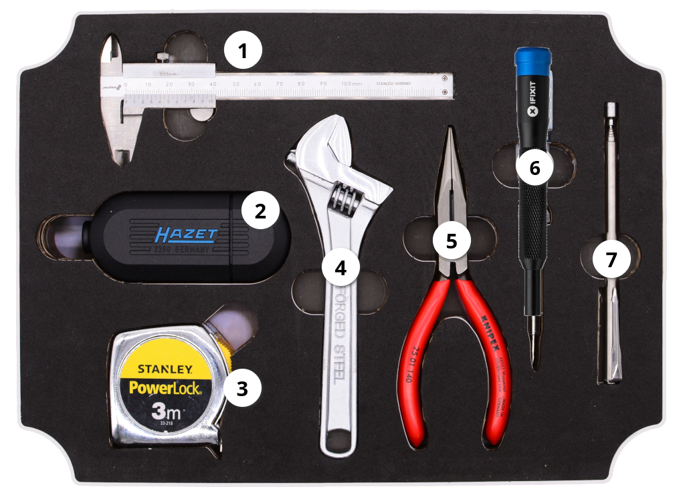

# Basiswerkzeuge (repair-m04b)

**Zusammenfassung:**

> Dieses Modul enthält alle grundlegenden Handwerkzeuge für die manuelle Arbeit bei der Reparatur von Haushalts- und Allgemeingeräten. Es ist ein Basis-Set an Werkzeugen, das bei den meisten Aufgaben hilft.

1. Mini-Schieblehre
2. Kombinations-Schraubendrehergriff mit Bit-Set (Verlängerung, Aufnahme: ¼")
3. Maßband
4. Verstellbarer Schraubenschlüssel
5. Spitzzange
6. Schraubendreher iFixit 4-mm-Bit-Halter (in letzter Minute als Ersatz für den Phasenprüfer eingebaut — siehe [DESIGN-DECISIONS.de.md](../../DESIGN-DECISIONS.de.md), 25.09.26: für diese Aussparung gibt es keine Laser-Cutting-Datei, sie wurde händisch mit einem Dremel ausgefräst)
7. Teleskop-Magnet

---

**Didaktischer Einsatz:**

Dieses Modul hat grundlegende Reparaturszenarien im Blick: Gehäuse öffnen, verdrehte Knöpfe/Kontakte/Kabel. Muttern und Schrauben öffnen und relevante Durchmesser sowie Abstände/Aussparungen messen. Es empfiehlt sich, dieses Modul gezielt bei konkreten Reparaturaufgaben an Haushaltsgeräten einzusetzen.
