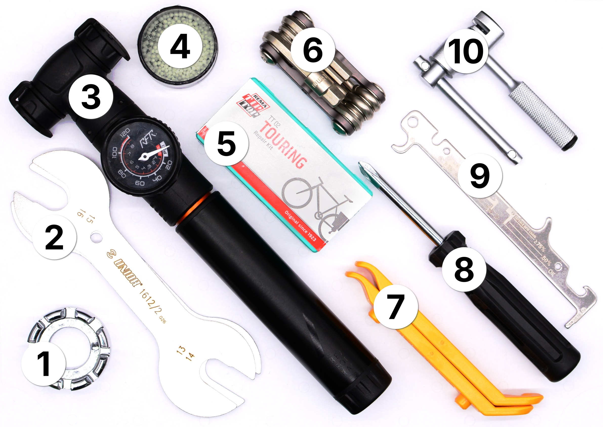

# Fahrrad-Basics (repair-m06)

**Zusammenfassung:**

> Dieses Modul enthält die grundlegenden Werkzeuge für die alltägliche Fahrradreparatur und -wartung: Reifenpannen beheben, die Kette einstellen/kürzen, Bremsen, Lager und Speichen einstellen sowie allgemeine Reparaturen unterwegs.

1. Speichenschlüssel
1. Konusschlüssel-Set
1. Mini-Pumpe
1. Lochschnüffler
1. Flickzeug
1. Multitool
1. Reifenheber
1. Umsteckschraubendreher
1. Kettenmesslehre
1. Kettennieter

---

**Didaktischer Einsatz:**

Dieses Modul deckt die häufigsten Fahrrad-Reparaturszenarien ab: einen Platten beheben, den Kettenverschleiß prüfen und grundlegende Laufrad-Wartung. Fahrradreparaturen sind einfach, risikoarm und für viele gut nachvollziehbar – ein guter Einstiegspunkt für praktische Reparaturbildung im Alltag.
