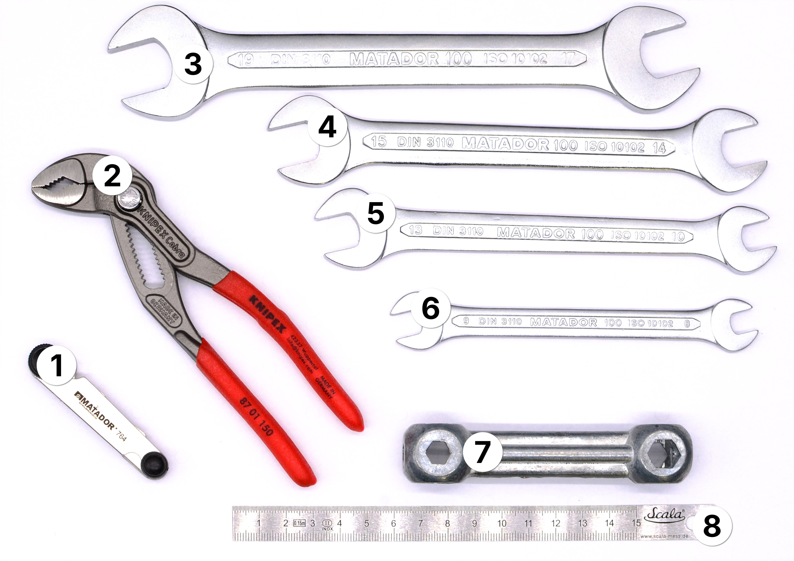

# Schraubenschlüssel (repair-m07)

**Zusammenfassung:**

> Dieses Modul enthält eine Reihe von Schraubenschlüsseln, Zangen und Messwerkzeugen für mechanische Reparaturaufgaben über das Basis-Set hinaus.

1. Gewindeschablone
1. Wasserpumpenzange
1. Doppelmaulschlüssel 17/19 mm
1. Doppelmaulschlüssel 14/15 mm
1. Doppelmaulschlüssel 10/13 mm
1. Doppelmaulschlüssel 8/9 mm
1. Knochenschlüssel
1. Stahlmaßstab

---

**Didaktischer Einsatz:**

Dieses Modul erweitert das Basis-Set um Schraubenschlüssel und Zangen mit größerem Größenbereich, geeignet für Möbelmontage, Fahrradwartung und Haushaltsmechanik-Aufgaben, die mehr als den Standard-Verstellschlüssel erfordern.
