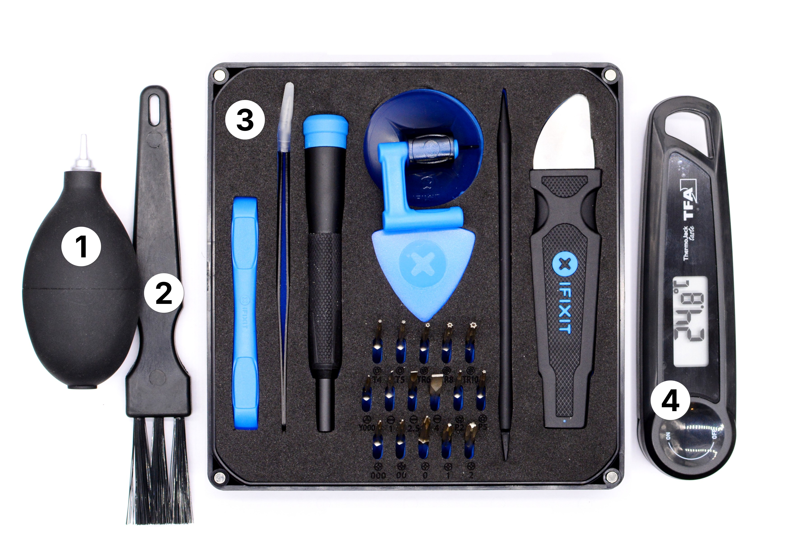

# Elektronik-Basics (repair-m08)

**Zusammenfassung:**

> Dieses Modul enthält die grundlegenden Werkzeuge, um elektronische Geräte sicher zu öffnen, zu reinigen und zu reparieren.

1. Staubbläser
1. Antistatischer Reinigungspinsel
1. iFixit Elektronik-Werkzeugset
1. Thermometer

---

**Didaktischer Einsatz:**

Dieses Modul ist für einen ersten, vorsichtigen Blick ins Innere elektronischer Geräte gedacht: Gehäuse/Displays öffnen, Staub entfernen und einfache defekte Teile reparieren/austauschen. Es bereitet auf die diagnostischere Arbeit in [repair-m09](repair-m09.de.md) vor.
