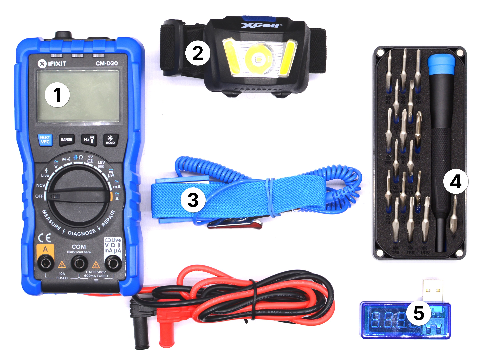

# Elektronik-Fehlersuche (repair-m09)

**Zusammenfassung:**

> Dieses Modul enthält Werkzeuge zur Diagnose und zum Testen von elektronischen Geräten und Bauteilen.

1. Digitales Multimeter
1. Stirnlampe
1. Antistatik-Armband
1. iFixit Präzisions-Bit-Set (inkl. 4-mm-Präzisions-Bits (+Y00))
1. USB-Ampere-/Voltmeter

---

**Didaktischer Einsatz:**

Dieses Modul baut auf [repair-m08](repair-m08.de.md) auf und führt in die grundlegende Elektronik-Fehlersuche ein: Spannung und Strom messen, Bauteile testen und sicheres Arbeiten an Geräten mit niedriger Gleichspannung.
