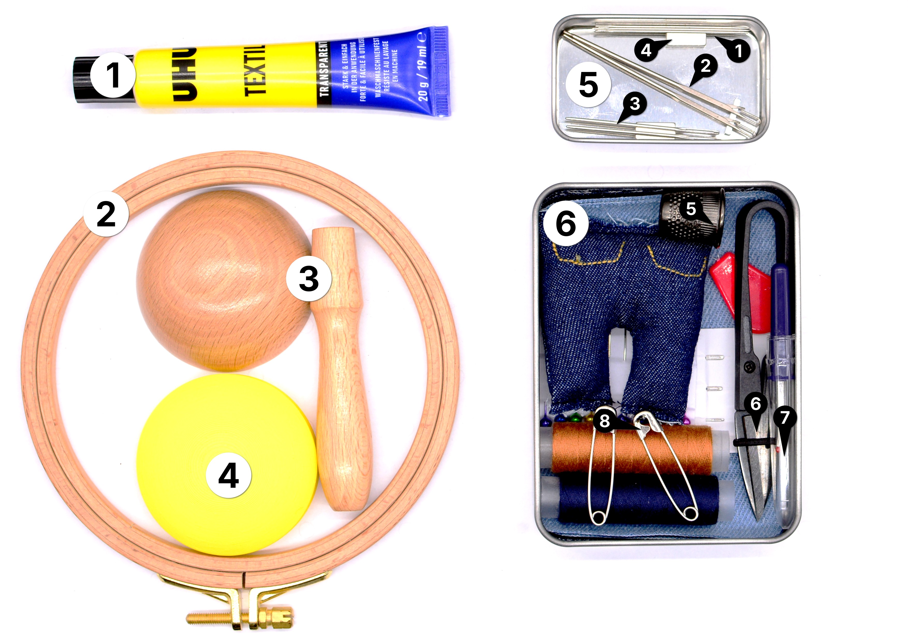

# Textilien (repair-m10)

**Zusammenfassung:**

> Dieses Modul enthält Werkzeuge zum Reparieren und Ausbessern von Textilien und Kleidung.

1. Textilkleber
1. Stickrahmen
1. Stopfpilz
1. Stopfpilz (3D-gedruckt)
1. Magnetische/Metall-Nadelbox (inkl. Zusätze: 1: 3× Nähnadeln 2: 2× Einfädler-Stopfnadeln 3: 2× Stopfnadeln 4: Kleine Magnete)
1. Jeans-Reparaturset (inkl. Zusätze: 5: Fingerhut 6: Fadenschneider-Schere 7: Nahttrenner 8: Sicherheitsnadeln auf einem Magneten)

---

**Didaktischer Einsatz:**

Dieses Modul deckt grundlegende Ausbesserungstechniken ab: Löcher stopfen, Nähte reparieren und Textilien wie Jeans flicken – praktische Alltags-Reparaturfähigkeiten, die über das Nähen von Kleidung hinausgehen.
