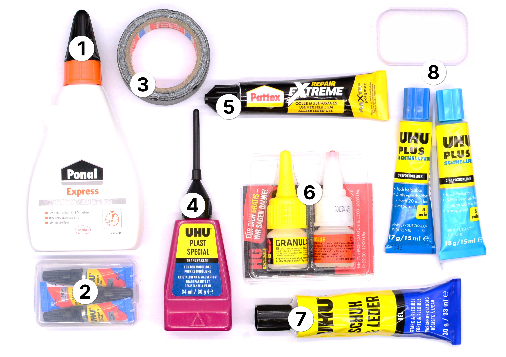

# Kleben (repair-m11)

**Zusammenfassung:**

> Dieses Modul enthält eine Reihe von Klebstoffen für unterschiedliche Materialien, für Reparaturen, die Kleben statt mechanischer Befestigung erfordern.

1. Holzleim
1. Sekundenkleber
1. Gewebeband
1. Kunststoffkleber
1. Kunststoff-Reparaturkleber
1. Epoxidharz-Spachtelmasse-Set
1. Schuh- & Lederkleber
1. 2-Komponenten-Epoxidkleber

---

**Didaktischer Einsatz:**

Dieses Modul stellt verschiedene Klebstoffe und ihre Einsatzbereiche vor: schnelle Reparaturen, strukturelle Verbindungen und materialspezifische Kleber für Kunststoff, Holz, Leder und Schuhe – eine gute Gelegenheit, über Materialeigenschaften zu sprechen und warum nicht ein Kleber für alle Reparaturen passt.
