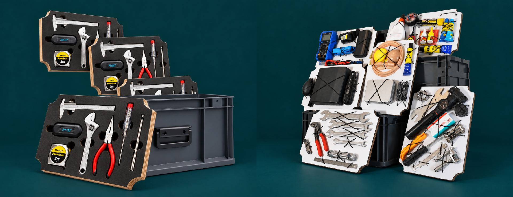

# Universal Repair Kit
**Educational Edition**

(English version)

## Modules included
- Basic Tools ([repair-m04a](repair-m04a.md) or [variant -m04b](repair-m04b.md)
- Bike-Basics (repair-m06)
- Wrenches (repair-m07)
- Electronics Basics (repair-m08)
- Electronics Troubleshooting (repair-m09)
- Textiles (repair-m10)
- Gluing (repair-m11)
- Extras: packing & additional material info

---

**Website:** <https://askotec.openculture.agency/repairkit>