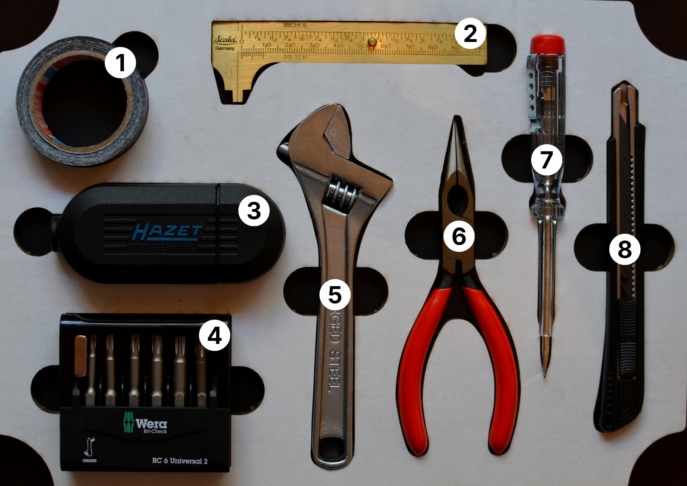

# Basic Tools (repair-m04b)

**Summary:**

> This Module contains all basic hand tools for manual work on repairing household and general devices. It is a basic set of tools to help you with most tasks. 

(#ToDo new image replacement needed)

1. ~~Mini duct tape~~
2. Mini caliper 
3. Combination screwdriver handle with bit set (extension, socket: ¼")
4. ~~2× Bit set (Torx bits, socket: ¼", magnet for better screw-driving)~~ Tape Measure
5. Adjustable wrench
6. Pointed pliers
7. Screwdriver power tester (optional replacement: iFixit 4mm Bit Holder)
8. ~~Cutter~~ Telescopic Magnet

---

**Educational Application:**

This module has basic repair cases in mind. Casings to be opened, twisted nobs/contacts/wires. Opening nuts and bolts and measuring relevant diameters and distances/pockets.

