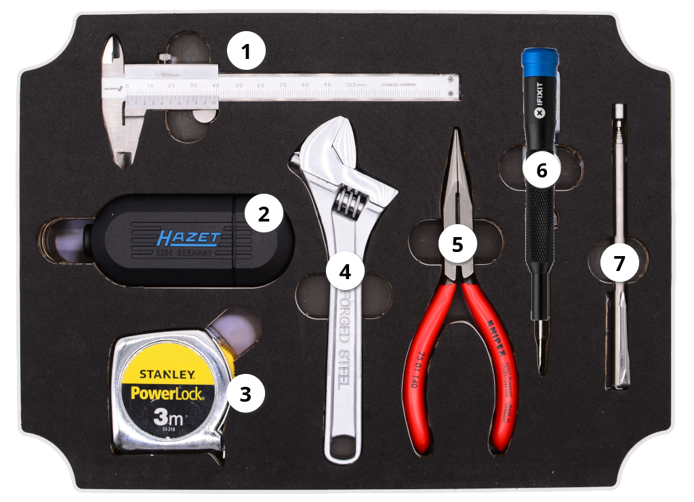

# Basic Tools (repair-m04b)

**Summary:**

> This Module contains all basic hand tools for manual work on repairing household and general devices. It is a basic set of tools to help you with most tasks. 

1. Mini caliper 
2. Combination screwdriver handle with bit set (extension, socket: ¼")
3. Tape Measure
4. Adjustable wrench
5. Pointed pliers
6. Screwdriver iFixit 4mm Bit Holder
7. Telescopic Magnet

---

**Educational Application:**

This module has basic repair cases in mind. Casings to be opened, twisted nobs/contacts/wires. Opening nuts and bolts and measuring relevant diameters and distances/pockets.

