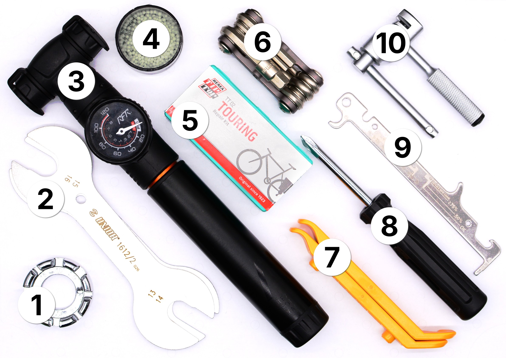

# Bike Basics (repair-m06)

**Summary:**

> This module contains the basic tools for everyday bike repair and maintenance: fixing punctures, adjusting the chain, and general on-the-go fixes.

1. Mini Pump
2. Puncture Detector
3. Puncture Repair Kit
4. Tire Lever
5. Chain Wear Indicator
6. Chain Tool
7. Multi-Tool
8. Bit Screwdriver
9. Spoke Wrench
10. Cone Wrench Set

---

**Educational Application:**

This module covers the most common bike repair scenarios: fixing a flat tire, checking chain wear, and basic wheel maintenance. Bike repairs are tangible, low-risk, and widely relatable, making this a good entry point for hands-on repair education.
