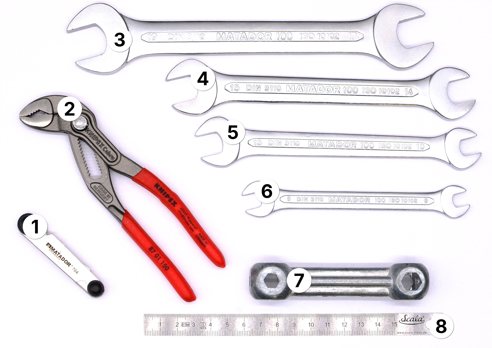

# Wrenches (repair-m07)

**Summary:**

> This module contains a range of wrenches, pliers, and measuring tools for mechanical repair tasks beyond the basic toolset.

1. Bone Wrench
2. Water Pump Pliers
3. Steel Ruler
4. Thread Gauge
5. Open-End Wrenches (4 sizes: 8/9, 10/13, 14/15, 17/19 mm)

---

**Educational Application:**

This module extends the basic toolset with wrenches and pliers covering a wider size range, suitable for furniture assembly, bicycle maintenance, and household mechanics tasks that need more than the standard adjustable wrench.
