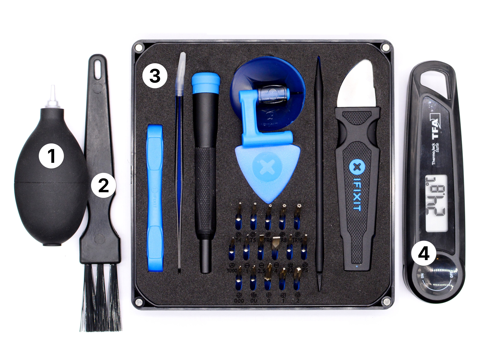

# Electronics Basics (repair-m08)

**Summary:**

> This module contains the basic tools for safely opening, cleaning, and inspecting electronic devices.

1. Electronics Toolkit
2. Anti-Static Brush
3. Dust Blower
4. Thermometer

---

**Educational Application:**

This module is meant for a first, careful look inside electronic devices: opening casings, cleaning out dust, and handling sensitive components without static damage. It prepares for the more diagnostic work in [repair-m09](repair-m09.md).
