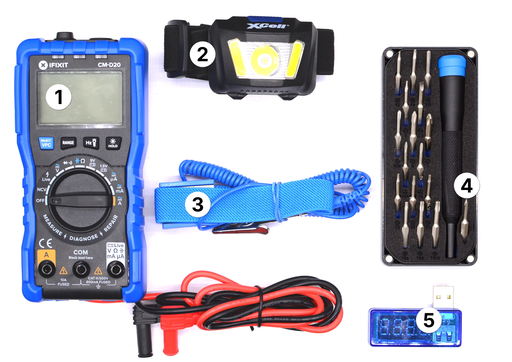

# Electronics Troubleshooting (repair-m09)

**Summary:**

> This module contains tools for diagnosing and testing electronic devices and components.

1. Digital Multimeter
1. Headlamp
1. Anti-Static Wrist Strap
1. Precision Bit Set (incl 4mm Precision Bits (Y00 & Torx Security TR9))
1. Ammeter/Voltmeter

---

**Educational Application:**

This module builds on [repair-m08](repair-m08.md) and introduces basic electronic troubleshooting: measuring voltage and current, testing components, and safely working on powered devices.
