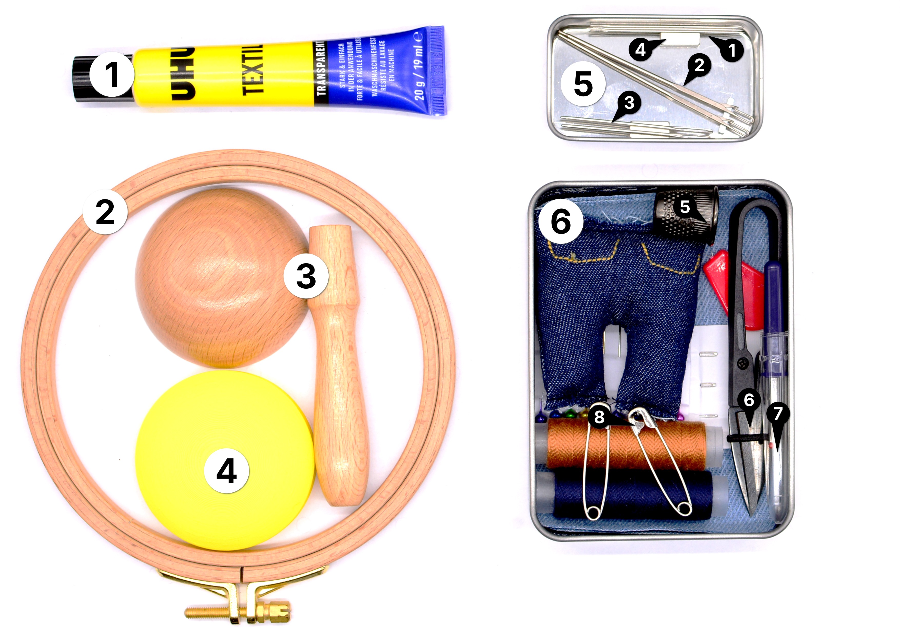

# Textiles (repair-m10)

**Summary:**

> This module contains tools for repairing and mending textiles and clothing.

1. Embroidery Hoop
2. Darning Mushroom
3. Darning Mushroom (3D-printed)
4. Seam Ripper
5. Thimble
6. Assorted Needle Set
7. Self-Threading Darning Needle
8. Magnetic Needle Case
9. Thread Cutter
10. Safety Pins
11. Small Magnets
12. Jeans Repair Kit
13. Fabric Glue

---

**Educational Application:**

This module covers basic mending techniques: darning holes, repairing seams, and patching textiles such as jeans — practical, everyday repair skills that apply well beyond the classroom.
