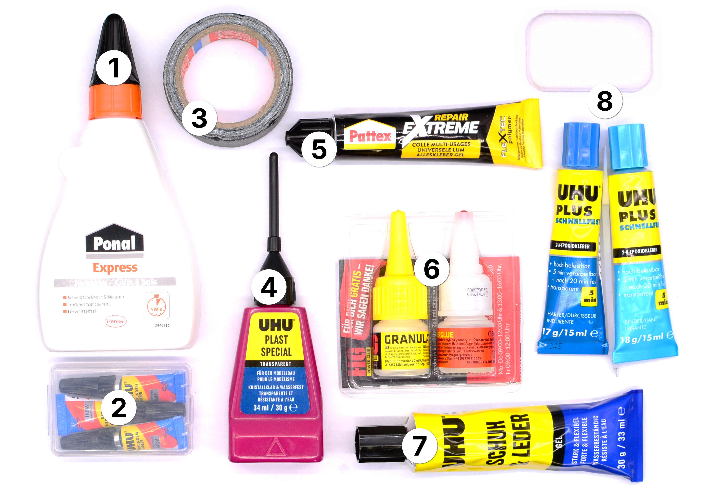

# Gluing (repair-m11)

**Summary:**

> This module contains a range of adhesives for different materials, for repairs that call for gluing rather than mechanical fixing.

1. Duct Tape
2. Super Glue
3. 2-Component Epoxy Glue
4. Epoxy Putty Glue Set
5. Plastic Glue
6. Plastic Repair Glue
7. Shoe & Leather Glue
8. Wood Glue

---

**Educational Application:**

This module introduces different adhesives and when to use them: quick fixes, structural bonds, and material-specific glues for plastic, wood, leather, and shoes — a good opportunity to discuss material properties and why one glue doesn't fit all repairs.
